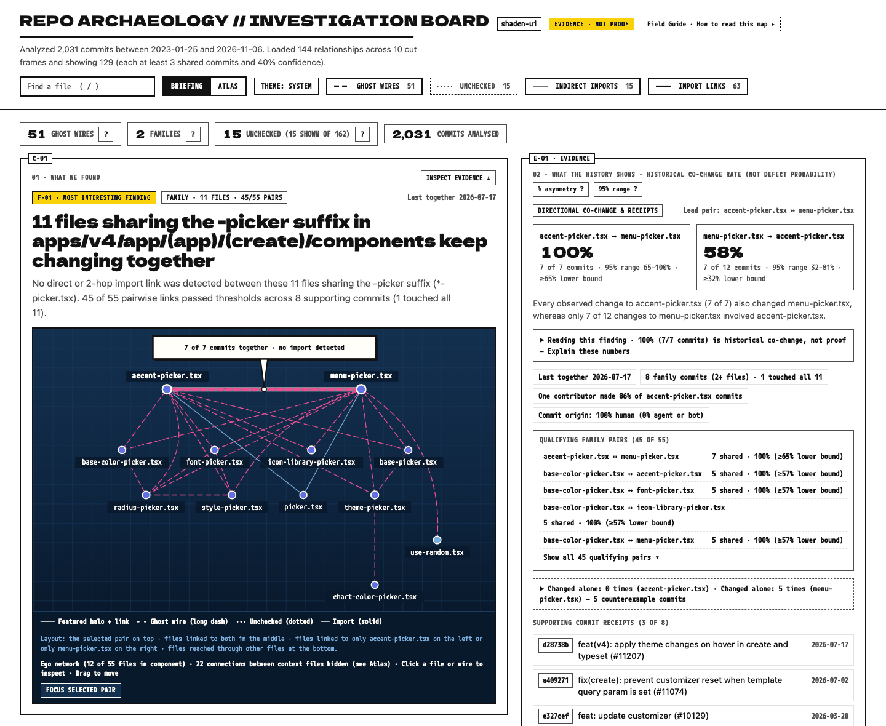
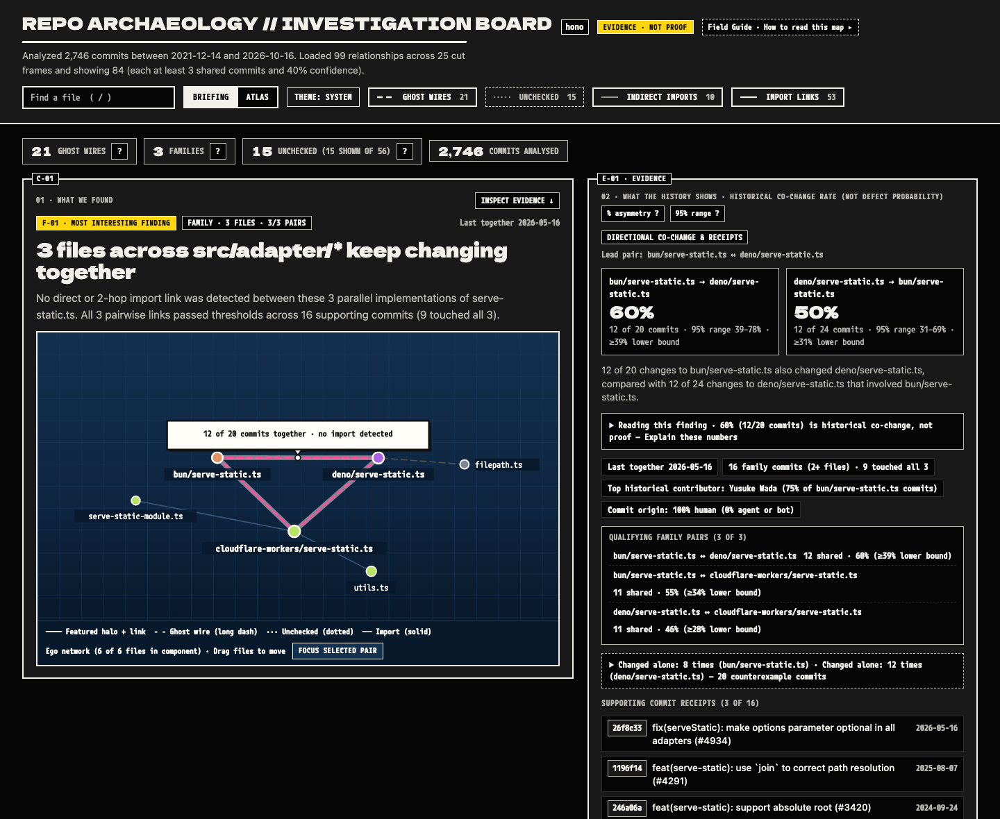

# Changelog

All notable changes to **Repo Archaeology** are documented in this file.

The format is based on [Keep a Changelog](https://keepachangelog.com/en/1.1.0/), and this project adheres to [Semantic Versioning](https://semver.org/spec/v2.0.0.html).

## [Unreleased]

Minor release.

### Changed
- **`--style rich` is rendered by [`@frame12/terminal`](https://www.npmjs.com/package/@frame12/terminal) (RA-21):** `scan`, `diff`, `file`, `explain` and the bare command build a FRAME/12 snapshot with a typed, pure adapter (`src/report/frame12-terminal.ts`) and render it with the package's grammar, capability detection, width tiers, ambiguous-width glyph twins, color rules, OSC 8 links and sanitizing, so Repo Archaeology and FRAME/12 no longer keep two terminal implementations. One finding per relationship ("`<to>` usually changes with `<from>`") with its relationship, confidence and 95% Wilson interval, and commit receipts; the classic counts as metrics; caveats as warnings; copyable `explain` commands as next steps. Every number shown is a `--json` number. Before/after gallery: [`docs/gallery/rich-terminal/`](docs/gallery/rich-terminal/README.md).
  - Receipts are the commits `--json` lists in `evidence`; `--full-evidence` adds every stored supporting commit (the card lists 3 and counts the rest; screen-reader output lists all).
  - `explain`'s patch hunks are not part of the rich layout; rich `explain` suggests the `--style classic` command that shows them.
  - On a pipe or file, rich output has no escape sequences unless `FORCE_COLOR` asks (the package's linear rules).
  - The track-record line is Repo Archaeology's shared sentence, as in classic and Markdown.
  - Diff CODEOWNERS handles are printed without `@` (the package strips the zero-width break classic uses to keep copied handles from pinging).
- **Dependency policy:** runtime dependencies are now `commander`, `typescript` and `@frame12/terminal` (exact-pinned at 0.1.0; it brings `@frame12/tokens@0.2.0`). Its optional `ink` and `react` peers are not installed or loaded. Install size, measured by `scripts/install-size.mjs` from `npm pack` of 0.11.0 and this version: tarball 1.9 KB smaller, installed `node_modules` +362.7 KB (+484 KB on disk, +62 files).

### Added
- `--screen-reader` (or `FRAME12_SCREEN_READER=1`): `--style rich` as plain, append-only lines, one fact per line, every receipt and full path.
- `--columns <n>`: lay out `--style rich` for `n` columns (20-400).
- "Accessibility in the terminal" in the README (screen-reader mode, ASCII, `NO_COLOR`, motion).

### Removed
- Repo Archaeology's own rich renderer (`src/report/terminal-rich.ts`: `formatRich*`, `printRich*`) and its capability, sanitizing, display-width and OSC 8 code; `FRAME12.terminal` (ANSI and RGB values) from `src/style/frame12.ts`. The map's palette is unchanged. `parseTrustedRemoteRepoUrl`, `isValidCommitSha` and the 12 fps spinner stay.

### Unchanged
- `classic` output, `--json`, `--format markdown`, the HTML map in both styles and exit codes are byte-identical (pinned by `test/unchanged-outputs.test.ts`, recorded from 0.12.0).

## [0.12.0] - 2026-11-11

### Added
- **Base-tree import graphs from the head session (RA-20):** `repo.importGraph({ files, at })` and `repo-archaeology imports --at <ref>` return the import graph of another commit's tree, typically a pull request's base, without opening a second session or reading any history. `importGraph({ files: removedPaths, at: mergeBase })` lists the importers a PR's deleted or renamed-away files had at the base (Gutter's `broken-import`, GU-31). Files whose blob is the same in both trees are not read or parsed again: their extracted import statements are reused from the session's own graph. Resolution always runs against `at`'s own tree and configuration (`tsconfig`, `package.json`, workspaces, `go.mod`, `pyproject.toml`, …), so it equals a fresh `openRepository({ head: at })` with the session's settings. That is tested on TS, Go and Python fixtures, on this repository at two releases, and on 40 real merged PRs in hono and ng-aquila. The result adds a top-level `at: { ref, sha }` (additive, `schemaVersion: 1`). `at`'s `.repo-archaeology.json` is never read. On ng-aquila the base importers of removed paths cost 19% of the second session at p95 (335 vs 1780 ms; hono: 31%, 208 vs 673 ms) with identical results on all 40 PRs (see [`docs/design/ra-20/README.md`](docs/design/ra-20/README.md); `scripts/bench-base-graph.mjs` reproduces it).
- **`role` on Python and Go import edges (additive):** every `"python-module"` edge says what its target is to the import: `"module"` (the module the specifier names), `"init"` (an `__init__.py` that runs on the way) or `"name"` (a submodule taken by `from pkg import mod`, with `name: "mod"`). Every `"go-package"` edge is `"module"`. TS/JS edges carry no `role`, and their output is byte-identical. The human `imports` output tags non-`module` Python edges (`init`, `name <x>`). Schema: `common.schema.json#/$defs/ImportTargetRole`; see [`docs/json.md` §5.9.1](docs/json.md#591-target-roles-and-base-tree-graphs-ra-20).

### Changed
- **Python submodules behind a PEP 562 `__getattr__`:** `from pkg import x` (or `from . import x` inside `pkg/__init__.py`), where `x` exists on disk and the package's only dynamic trait is one module-level `def __getattr__`, now gives a `heuristic: true`, `role: "name"` edge in the import graph. Before, it gave no edge (found by Gutter in `github/spec-kit`). Relationship classification ignores these edges, so such pairs stay `unknown` in `scan`, `diff`, `file`, `explain` and `map`. Other dynamic namespaces (star imports, `globals()`, `sys.modules`, …) are unchanged.

### Internal
- Language analyzers' `extract` depends on a file's text and path only; Go's module lookup moved to a new `complete` hook.

## [0.11.0] - 2026-11-10

### Added
- **Choose which `.repo-archaeology.json` applies (RA-19):** By default the config comes from the code being analyzed, so a pull request could add its own config that ignores the file it forgot to change and hide its own omission (found in Gutter's GU-05 review). Two new global options, mutually exclusive (exit 2 when combined), let the caller decide instead:
  - `--config-from <ref>` reads the file from that commit's tree, with or without `--head`, through the same checks as `--head` (regular file, 64 KB cap, valid settings). A missing file means no config. An invalid file or a ref that is not a commit is an error (exit 2) instead of a fallback. CI and review bots should pass the base branch: `diff --base origin/main --config-from origin/main`.
  - `--no-config` reads no config file at all.
  - Library parity: `openRepository({ configRef })`. Combining it with `useConfigFile: false` is a `ConfigError`.
  - Explicit flags and `settings` still override config values.
- **`meta.config` (additive, `schemaVersion: 1` unchanged):** every JSON output reports which config applied: `{ source: "working-tree" }`, `{ source: "ref", ref, sha }` (`--config-from`, or `--head <ref>` alone, which reads `<ref>`'s tree) or `{ source: "none" }`. Schema: `common.schema.json#/$defs/ConfigMeta`. Without either option, output is unchanged apart from this field; the golden snapshots differ only by it.

### Research
- **RA-18 surface pilot (research only, verdict NOT CORRECT, [`docs/research/surface-pilot.md`](docs/research/surface-pilot.md)):** A preregistered pilot asked "what did this PR change about what a file exports, and which untouched files still use it?".
  - **What was built:** an internal, unpublished analysis in [`src/surface/`](src/surface/), excluded from the build and from `dist`. It reads each changed file's syntactic export surface at base and head (`createSourceFile` only), with names, kinds, required and total parameters, required properties, opaque `export *` and static CommonJS forms. It then finds untouched consumers through the existing resolver, with a compiler-coverage label per consumer. Research scripts in [`scripts/surface-pilot/`](scripts/surface-pilot/) generate seeded mutations in hono, eslint and vuejs/core, using a TypeScript language-service oracle as ground truth. They also replay 400 real PRs, and the raw records are committed under [`docs/research/data/surface-pilot/`](docs/research/data/surface-pilot/).
  - **Result:** no false positives (0/360 contract-preserving controls). Removal recall was 0.80 in hono and vuejs/core and 0.04 in eslint, so the verdict is NOT CORRECT. A labeled post-hoc check shows that every positive whose consumer names the export directly or through explicit re-exports was detected (212/212). The misses come from the preregistered oracle's reference-based ground truth, from namespace imports, and from `export *`.
  - **Relevance:** real PRs rarely produce the fact. 1 of 200 hono PRs and 0 of 200 eslint PRs had an untouched consumer of a removed or changed export.
  - **Not affected:** no CLI command, JSON field, schema, library export or v1 output changed, and runtime dependencies are unchanged.

## [0.10.0] - 2026-11-10

### Added
- **Per-pair track record on `diff` suggestions (RA-06, [`src/model/track-record.ts`](src/model/track-record.ts)):** each suggestion gets an optional, additive `trackRecord` (`schemaVersion: 1` unchanged): replaying the baseline history in commit order with no future information, how often a threshold trigger for that exact `from → to` pair (`from` changed without `to` while the model linked them) was followed by a change to `to` within 48 hours (`fired`, `confirmed`, `triggers`, `coChanged`, `precision`, `interval`, `windowHours`, `evaluated`, `excluded`), or `{ fired: 0, reason: "never_fired" }` / `{ reason: "limited_history" }`. Classic, `--style rich` and Markdown output add one counts-first line per suggestion ("Before: 5 times this changed without permissions.ts; it changed within 48 h after 4 (not proof those were fixes)."). New `diff` flags `--no-track-record` and `--track-window <hours>` (1–720), and `repo.diff({ trackRecord, trackWindowHours })`. Definitions are in [`docs/json.md`](docs/json.md#521-track-record-suggestionstrackrecord-commonschemajsondefstrackrecord).

### Changed
- **One numerical policy for weighted co-change counts ([`src/model/cochange.ts`](src/model/cochange.ts)):** with `--origin-weights` and no half-life, weighted counts are now `Σ count[origin] × weight[origin]` over integer counts instead of a running float sum, and with `--half-life` recency weights accumulate in one canonical chronological order, relative to an epoch that moves only with commit times (one exponentiation per commit, as before). The values are mathematically unchanged; only the last floating-point bits can differ, so a confidence that sits exactly on `--min-confidence` is decided the same way regardless of the order commits arrive in, and the RA-06 replay matches `diff` exactly. Unweighted results are unchanged.

## [0.9.0] - 2026-11-10

### Added
- **Go and Python Import Analysis ([`src/imports/go.ts`](src/imports/go.ts), [`src/imports/python.ts`](src/imports/python.ts), [`src/imports/toml.ts`](src/imports/toml.ts)):** Pairs of `.go` and `.py` files used to be `unknown`; now they are classified as `direct`, `indirect` or `ghost` when the analyzer can tell, and stay `unknown` whenever it can't. Both analyzers are dependency-free bounded lexers and never execute Go, Python or build tooling.
  - **Go:**
    - Imports resolve against every `go.mod` (nested ones included), their `replace` directives and a root `go.work` (`use` members, the members' replacements, and `go.work` replacements, which take precedence), with complete-segment module matching.
    - An import links to the imported package's member files (`via: "go-package"`; `explain` says `imports package <path>`): not `_test.go`, `_`/`.`-prefixed or `//go:build ignore` files. When a directory's remaining files declare different packages, none is guessed: each of them is an unchecked possible target.
    - Two files of one package (same directory and `package` clause) share scope without imports, so their pair is `unknown` (`same Go package: files share scope without imports`), never `ghost`. For the same reason, a file whose package sibling imports the partner counts as `indirect` (`shares a Go package with X, which imports package P`).
    - An unreadable, unparseable or nested `go.work`, conflicting workspace replacements and replacements without a usable `go.mod` keep the affected imports unresolved (`unsupported-config`), not external.
  - **Python:**
    - Imports resolve against the source roots: the repository root, `src/`, project directories, and `pyproject.toml` setuptools (`packages.find.where`, `package-dir`, including package-name remaps such as `{public = "impl"}`), poetry and hatch settings, read with a minimal TOML subset reader.
    - Absolute imports are resolved by elimination against that local namespace, so a local module shadows the standard library and no dependency list is needed.
    - Imports follow the import system: `import a.b.c` also depends on `a/__init__.py` and `a/b/__init__.py` (except initializers of packages that contain the importing file, which ran before it anyway, unless the import reads a name from one), a regular package wins over a same-named module, which wins over a namespace directory, and `from pkg import name` is the submodule only when `pkg/__init__.py` cannot bind `name` at module level (otherwise the pair with that submodule is unchecked).
    - Also handled: relative imports, namespace packages, and `importlib.import_module("…")`, `runpy.run_module("…")` and `__import__("…")` calls (a literal `fromlist` adds its submodules), including aliases (`import importlib as il`, `from importlib import import_module as load`), calls inside f-string replacement fields and literal `exec("import …")` (`kind: "dynamic"`). Rebound or escaping loader names, path-based loaders (`runpy.run_path`, `spec_from_file_location`, `SourceFileLoader`) and computed `exec`/`eval` count as dynamic loads; a keyword argument named like a loader does not.
    - `setup.cfg` (`package_dir`, `[options.packages.find] where`) and literal `setup.py` `package_dir` dicts and `find_packages("…")` are read as text (never executed), as are hatch wheel `sources`.
  - **When results stay `unknown`:**
    - Lexer failures, malformed import blocks, unusable manifests, computed dynamic imports, a top-level name defined in several source roots and the session edge budget make a file incomplete, which keeps its pairs `unknown`.
    - Third-party imports are external and never make a file incomplete, unless a project manifest could not be read at all (unreadable, oversized, TOML outside the subset, a computed `setup.py` `package_dir`): then a name that is neither local nor standard library is unresolved (`unsupported-config`), because it might be a package we missed. A manifest that declares a name in a form we do not model (a dotted `package-dir` key, a nested hatch source) makes only that name unresolved.
    - Uncertainty is per target where possible: a `from pkg import name` that may be an attribute, a Go directory holding several packages, and package files past the 200-file cap keep only the pairs with those files `unknown`, and the importer's other pairs are still checked.
  - **Warnings and docs:** Manifest problems, in-repo modules imported without a local mapping and budget hits are reported in `meta.warnings`. The README has a new *Language support* table.
- **JSON contract (additive, still `schemaVersion: 1`):** `ImportResolutionVia` gains `"go-package"` and `"python-module"` ([`schema/common.schema.json`](schema/common.schema.json)), and `imports --json` `languages` can include `"go"` and `"python"`. [`docs/json.md`](docs/json.md) and [`docs/api.md`](docs/api.md) now state that the `via`, `reasonCode` and `languages` value sets may grow within `schemaVersion: 1` and that consumers must tolerate unknown values. This enum growth is why the next release is a minor version.

### Changed
- **One Import-Analysis Pipeline ([`src/imports/analysis.ts`](src/imports/analysis.ts)):** Relationship classification (`scan`, `diff`, `file`, `explain`, `map`) and the import graph (`imports`) now read every file through the same `analyzeFile` step and a `LanguageAnalyzer` registry, instead of each calling the TypeScript extractor and resolver on its own, so the two cannot drift apart. TS/JS output is unchanged: golden JSON snapshots of every command on two fixtures and on this repository's own history ([`test/golden.test.ts`](test/golden.test.ts)) are byte-identical before and after, and a parity test checks that both see the same edges for every fixture file.

## [0.8.0] - 2026-11-10

### Added
- **Seeded Browser Stress Tests for the Briefing Plate and the Atlas ([`test/map-plate-stress.test.ts`](test/map-plate-stress.test.ts), [`test/map-atlas-stress.test.ts`](test/map-atlas-stress.test.ts), [`test/fixtures/atlas-graphs.ts`](test/fixtures/atlas-graphs.ts)):** Seeded random walks (clicks, keyboard, touch, drag, zoom, plain scrolling, filters, search, deep links, resizes, view switches) that check invariants after every step: no page errors, finite geometry, no unexplained blank frames, selection and inspector agree, layout guarantees on untouched plates, and bounded DOM growth. The Atlas suite runs ten generated graph shapes (empty, pairs, star, clique, chain, 300-file component, 120 components, unchecked-only groups, awkward names) across desktop, hi-DPI with reduced motion, forced colors, and 390px and 320px touch viewports. `RA_STRESS_SEED`, `RA_STRESS_STEPS` and `RA_STRESS_HTML` explore other walks and real maps; the canvas exposes a read-only `__atlasSnapshot()` for these tests.

### Changed
- **Atlas Overview Level of Detail ([`src/map/template.ts`](src/map/template.ts), [`src/map/layout.ts`](src/map/layout.ts)):**
  - **No unexplained blank frames.** Cut frames whose relationships are all hidden by the filter bar draw a dashed border and say what is hidden and how to show it ("3 unchecked links hidden by filters · click to show"); clicking the frame, or the `Show hidden relationships` button in the overview panel (which lists the affected frames), turns those kinds on. Frames made only of unchecked links, which start hidden whenever other kinds exist, now sort last in their own `unchecked` band instead of opening the sheet (on shadcn-ui the first, fourth and fifth frames were blank by default).
  - **Folder groups for dense frames.** A frame with 25 or more files is drawn as up to seven folder groups, with the relationships between them, until it has roughly 4,000px² of screen per file, or something in it is selected or matched by search. Click a group to zoom to its files; click the frame to open it on its lead relationship. All relationships remain available in the panel lists, search and the zoomed-in frame.
  - **Readable text at any zoom.** Frame captions keep a constant on-screen size (they used to shrink with the sheet, to about 4px at fit-all) and shorten to fit narrow frames. File labels are ranked by their strongest relationship and placed only where they hit no other label or file, up to a per-frame budget for the space on screen; selected, hovered and searched files are always labelled.
  - **Fit covers every frame.** `Reset view` used to fit only the first 12 frames. It now fits all of them, or, when that would be unreadable (below 32% scale), fits the sheet's width from the top and says how many groups are shown.
  - **Clearer wording.** The inspector's section labels are `ATLAS · OVERVIEW` and `E-01 · EVIDENCE` (they were `C-01 / OVERVIEW` and `C-02 / EVIDENCE`, which collided with cut-frame ids), and an `Inspecting C-06 · a.ts ↔ b.ts` line names the frame and pair. The summary line now reads "Showing 129; the filter bar hides 15 unchecked links" instead of implying the thresholds removed them.
- **Release Workflow Runs the Browser Tests ([`.github/workflows/release.yml`](.github/workflows/release.yml)):** The release job now installs Playwright's Chromium; without it every browser suite skipped itself during release verification.

### Fixed
- **Scrolling the Page over the Briefing Plate Zoomed It ([`src/map/template.ts`](src/map/template.ts)):** A plain mouse wheel over the `C-01` plate was captured as zoom, so scrolling the page could zoom the plate, cut labels off at its edges and show `Reset plate`. A plain wheel now scrolls the page and briefly shows `Ctrl + scroll to zoom the plate` (`⌘` on macOS); `Ctrl`/`⌘` + wheel and trackpad pinch still zoom around the pointer.
- **Headings in the Empty and Filtered-Out Briefing States ([`src/map/template.ts`](src/map/template.ts)):** The "No findings match the active relationship filters" and empty-state headings now carry the `briefing-headline` id and are focusable like every other C-01 headline, so keyboard focus has a target after a filter change.

## [0.7.0] - 2026-11-09

### Added
- **Briefing Plate Keyboard Access & `Back to family` ([`src/map/template.ts`](src/map/template.ts)):** Files on the Cut `C-01` blueprint plate are now focusable buttons (`role="button"`, `tabindex="0"`, `Inspect <path>` label) that select with `Enter`/`Space` and keep focus after the Briefing re-renders. After pivoting from a Finding Family to one of its pairs (via a plate file, wire, or family pair row), C-01 shows a `← Back to family (N files)` button (`#back-to-family-btn`). The plate footer and node tooltips now say files and wires can be clicked to inspect.

### Changed
- **Pair-Centered Layered Blueprint Plate on One Shared Engine ([`src/map/plate-layout.ts`](src/map/plate-layout.ts), [`scripts/build-plate-layout.mjs`](scripts/build-plate-layout.mjs), [`src/map/copy.ts`](src/map/copy.ts), [`src/map/template.ts`](src/map/template.ts)):**
  - The Briefing plate is now laid out by one deterministic, dependency-free engine. The server calls it for the report's plates, and `npm run build:plate-layout` compiles the same source into `src/map/plate-layout.browser.ts`, which rich maps inline (`RAPlateLayout`) for plates rebuilt after a click. `npm run build` fails if the bundle is stale, and tests check that both environments produce identical geometry. This replaces the separate server arc layout and client force layout.
  - Rows show each file's relationship to the selected pair, not its strength: the pair on top, files related to both in the middle, files related to only one on that file's side, and family files reached through other files at the bottom. Files are ranked by their strongest relationship within each group, rows are packed from measured label widths (embedded `M PLUS 1 Code` metrics, CJK/emoji/combining-mark aware), rows are ordered with barycenter sweeps, adjacent swaps and sideways shifts against a documented objective (label and dot overlaps, wires through unrelated files, weighted crossings, wires under labels, wire length, movement from the previous plate), and plate height follows the content.
  - Wire selection is topology-aware instead of ring-based: the selected relationship and every wire to the pair are always drawn, every file keeps at least one wire, and optional context wires are added strongest first only while they pass through no unrelated file and add at most one crossing. Omitted wires are counted in the footer; finding files with no visible relationship under the current filters are disclosed rather than drawn.
  - Plates are laid out for the width they are shown at, so labels render at 13–16px instead of being scaled (previously 9px in a 1024px window and 22px at 640px). Plates narrower than 560px (phones, and the narrow two-column board) get a focused composition: the pair and its two closest files, the speech-balloon text as a caption under the plate, and the remaining files as an accessible list of 44px buttons that select them.
  - `npm run build` and the test suite check that the committed browser bundle matches the engine, ignoring CRLF checkouts on Windows.
  - Wires curve around what they would otherwise run through. After placement, each wire except the lead picks a bend (a quadratic curve whose control point comes from the shared `wireControlPoint`, so the drawn curve is the one that was scored) that keeps it off unrelated files, inside the plate, below the pair and out of the balloon, while reducing wires under labels and crossings. Curves stay attached when files are dragged.
  - Pointing at (or keyboard-focusing) a file lights up its wires and neighbours and fades the rest; pointing at a wire lights up its two files. Each file's accessible name says how many connections are shown, and the plate footer says "Point at a file to trace its wires". Highlighting skips touch and respects reduced motion.
  - Plates rebuilt after a click keep shared files near where the reader last saw them when the layout is otherwise a tie. The plate footer and the Field Guide (`Start Here`) explain the grouping.
  - On shadcn-ui (144 relationships) and this repository (133), rendered plates at 1440, 1024, 390 and 320px have no overlapping labels, labels on dots, clipped labels, orphaned files, labels under the balloon, or wires through unrelated files, off the plate or under the balloon. Against the v0.6.0 arc on desktop: wires through unrelated files 45 → 0 and 20 → 0, crossings 1,464 → 1,497 and 1,434 → 1,069, wires passing beneath label pills 113 → 368 and 92 → 131.
  - README screenshots show the new Briefing (shadcn-ui `*-picker.tsx` family, light and dark, ~137 KB each), and `docs/map-hallway-test.md` adds a five-person A/B protocol for the plate against the v0.6.0 arc.
- **Unnamed Contributor Concentration in Maps ([`src/map/copy.ts`](src/map/copy.ts), [`src/map/template.ts`](src/map/template.ts)):** Map reports no longer spotlight an individual. The Briefing evidence pill (`formatOwnerNote` and its client-side fallback) now reads `One contributor made N% of <file> commits` instead of `Top historical contributor: <name> (N% …)`, and the classic and rich side panels show `One contributor: N% of commits` instead of `Top author: <name>`. Both appear only when one human contributor made `>= 40%` of a file's analyzed commits. The JSON/`#ra-data` contract (`nodes[].topAuthor`, `evidence[].author`) is unchanged.

### Fixed
- **Briefing Plate File & Wire Selection ([`src/map/template.ts`](src/map/template.ts)):** Clicking a file or wire on the `C-01` blueprint plate threw `TypeError: Cannot read properties of undefined (reading 'hiddenBridge')` and never changed the selection, because the plate passed a bare edge index to `selectBriefingEdge`. Clicks now select the pair and update the `#f=` deep link.
- **Orphaned Files After Chord Pruning ([`src/map/copy.ts`](src/map/copy.ts), [`src/map/template.ts`](src/map/template.ts)):** Pruning dense family plates could leave a file (e.g. `chart-color-picker.tsx`) on the plate with no visible wire and nothing to select; each such file now keeps its strongest (highest Wilson lower bound) connection.
- **Balloon Covering a Lead File ([`src/map/copy.ts`](src/map/copy.ts), [`src/map/template.ts`](src/map/template.ts)):** The speech balloon is anchored above the higher lead endpoint instead of the lead wire's midpoint, so a sloped lead wire no longer tucks a featured file under the callout.
- **Clipped and Hidden Plate Labels ([`src/map/template.ts`](src/map/template.ts)):** Client-built plates keep every label inside the plate, try farther placements before overlapping another label, avoid the balloon pointer, prefer spots nearest their own file, and draw labels beneath the file dots so a later node can no longer paint over an earlier label. The compact (mobile) balloon shows up to 40 characters before truncating.

## [0.6.0] - 2026-11-09

### Added
- **Blueprint `Focus selected pair` Toggle & Chord Pruning (`#focus-pair-btn`, [`src/map/copy.ts`](src/map/copy.ts), [`src/map/template.ts`](src/map/template.ts)):**
  - Added a `Focus selected pair` / `Show ego network` toggle button (`#focus-pair-btn`, `aria-pressed`) in the Cut `C-01` blueprint footer whenever the ego network contains more than 2 files, isolating the primary pair on demand.
  - Pruned crossing non-incident neighbor-to-neighbor chords on dense `>= 5`-node cliques with an explicit `N connection(s) between context files hidden (see Atlas)` disclosure in `.f12-plate-meta`, kept non-featured context wires at or above the WCAG 1.4.11 3:1 non-text contrast threshold against the plate background and grid lines in both themes (`stroke-opacity="0.9"`, `stroke-width="1.35"`), and rendered the primary connection last with a crisp `#fffef9` chalk halo (`stroke-opacity="0.45"`).
- **Plain-Language Directional Asymmetry Summary & Single-Contributor Caveat ([`src/map/copy.ts`](src/map/copy.ts), [`src/report/glossary.ts`](src/report/glossary.ts), [`src/map/template.ts`](src/map/template.ts)):**
  - Added `formatAsymmetrySummary` (`.f12-dir-asymmetry`) directly beneath the two directional boxes in `E-01 · EVIDENCE` explaining why `A → B` and `B → A` percentages differ in one sentence, and replaced `(≥X% CI)` jargon with `≥X% lower bound`.
  - Added an unnamed single-contributor workflow habit note (`"One contributor made X% of the analyzed changes to …"`) in `Reading this finding` whenever one human contributor (canonicalized via `.mailmap`, excluding bots and non-human coding agents) made `>= 60%` of the lead file's analyzed commits (`topAuthorShare >= 0.6`).
- **Same-Directory Suffix Sibling Finding Families ([`src/model/families.ts`](src/model/families.ts), [`src/commands/scan.ts`](src/commands/scan.ts), [`src/commands/map.ts`](src/commands/map.ts), [`src/map/copy.ts`](src/map/copy.ts)):**
  - Grouped `>= 3` files in the same directory sharing a non-generic hyphenated suffix (such as `accent-picker.tsx`, `menu-picker.tsx`, `font-picker.tsx`, `picker.tsx` → `*-picker.tsx`, while excluding ubiquitous architectural layer suffixes like `-service`, `-controller`, `-slice`, `-store`, `-page`, `-card`) and `>= 3` qualifying pairs into a single Finding Family described as `"N files sharing the -<suffix> suffix in <dir>"`.

### Changed
- **Mechanical `git revert` & `Reapply` Commit Filtering (`revertsSkipped`, `--include-reverts`, [`src/model/history.ts`](src/model/history.ts), [`src/cli.ts`](src/cli.ts), [`src/config.ts`](src/config.ts), [`src/report/views.ts`](src/report/views.ts), [`schema/common.schema.json`](schema/common.schema.json)):** `HistoryBuilder` now skips mechanical `Revert "..."` and `Reapply "..."` commits by default across all commands so a commit, its revert, and a subsequent reapply are counted once rather than double- or triple-counted. Skipped revert commits are recorded in a dedicated `meta.revertsSkipped` counter and printed as `"N revert commit(s) skipped"` in classic, rich and Markdown headers, separate from `subjectSkipped` / `--skip-commits`. Pass `--include-reverts` or set `"skipReverts": false` in `.repo-archaeology.json` to opt out; the choice is echoed in `meta.settings.skipReverts` and `diff`'s `evaluation.effectiveOptions.skipReverts`. This changes counts for `scan`, `diff`, `file`, `explain`, `backtest` and all JSON consumers.
- **FRAME/12 Typography, Three-Tier Border Hierarchy & Board Alignment ([`src/map/template.ts`](src/map/template.ts)):** Increased reading sizes across `body` (`16px`), `.f12-lede` (`15.5px`), directional evidence, receipts, and ranked findings; established a 3-tier border hierarchy (`--f-rule` for primary storyboard panels, `--f-ink-2` for supporting evidence boxes, and `--f-grid` / left-accent for metadata pills and receipts); and set `.f12-board-grid { align-items: start; }` to eliminate the vertical stretch gap beneath `#cut-c01`.

## [0.5.1] - 2026-11-09

### Added
- **Interactive Briefing Blueprint Plate (`#featured-plate-svg`, [`src/map/template.ts`](src/map/template.ts)):**
  - Made the Cut `C-01` ego-network blueprint SVG in `map --style rich` fully interactive (`renderPlateSvg`), matching the `Atlas` and `--style classic` canvas controls: drag any file node to untangle overlapping traces in real time (updating connected wires, featured halos, label pills, and the speech-balloon callout tail/pin live), pan the blueprint background, cursor-centered `wheel` zoom (`0.3×`–`1.75×` with `gradientUnits="userSpaceOnUse"` cyanotype background and grid), click any wire or node to pivot the Evidence panel, and reset via the footer `Reset plate` button (`#reset-plate-btn`) or double-clicking the plate background.
  - Added `user-select: none` and `touch-action: none` on `.f12-plate-svg` so dragging nodes or panning the blueprint never accidentally highlights SVG `<text>` labels.

### Fixed
- **Dense-Clique Layout Spread on Briefing Blueprint Plates ([`src/map/copy.ts`](src/map/copy.ts), [`src/map/template.ts`](src/map/template.ts)):** Normalized spring attraction by node degree (`1 / Math.sqrt(max(deg_i, deg_j))`), widened seed and ring radii for 6–12 file cliques, and anchored outer neighbors toward their outer arc in both build-time `computeFeaturedPlateLayout` and client-side `buildDynamicPlate` so high-density multi-file cliques spread cleanly across the `760×420` plate instead of collapsing inward.

## [0.5.0] - 2026-11-08

> **Repo Archaeology v0.5.0 — Investigation Board & Field Guide**
>
> `repo-archaeology map --style rich` now opens as an interactive **Investigation Board** instead of a dense grid of miniature graphs. Start with the **Briefing** view to inspect your repository's strongest co-change finding, explore directional confidence and commit receipts, switch to **Atlas** for the full repository graph, and open the built-in **Field Guide** anytime for plain-English explanations of ghost wires, confidence intervals, and historical evidence.
>
> | Light Investigation Board (`--style rich`) | Dark Investigation Board (`--style rich`) |
> |---|---|
> |  |  |

### Added
- **FRAME/12 Investigation Board & Built-In Field Guide (`RA-17`, `--style rich` Briefing + Atlas + Field Guide, [`src/report/glossary.ts`](src/report/glossary.ts), [`src/map/copy.ts`](src/map/copy.ts), [`src/map/template.ts`](src/map/template.ts), [`scripts/design-concepts.mjs`](scripts/design-concepts.mjs)):**
  - Added pure copy, ranking, deep-link hash (`#f=<sourcePath>..<targetPath>`), and collision-free ego-network layout templates (`src/map/copy.ts`) for `map --style rich`, promoting the highest-priority finding family or pair to Cut `C-01` while keeping panel cut labels (`C-01`–`C-05`, `E-01`) distinct from finding IDs (`F-01`–`F-NN`).
  - Added the default **Briefing** view alongside **Atlas** (`Briefing | Atlas` view toggle in `src/map/template.ts`) with offline-embedded `Dela Gothic One` and `M PLUS 1 Code` woff2 fonts (`assets/fonts/`), a compact stat strip with native HTML `popover="auto"` `?` help explainers, a 3-beat plain-language guide (`01 · WHAT WE FOUND`, `02 · WHAT THE HISTORY SHOWS`, `03 · WHAT TO DO NEXT`), a `760×420` desktop / `340×240` mobile cyanotype blueprint plate SVG (`<= 12` ego nodes on desktop, `<= 6` on mobile) with speech-balloon callout and `#fffef9` chalk halo + `#ff4f9a` ghost-wire stroke (never using `--f-marker` `#ffd60a` as a stroke), side-by-side directional co-change cards (explicitly distinguishing `weighted` vs. `raw` rates) with labeled `% asymmetry ?` and `95% range ?` help pills, qualifying family pair breakdowns, counterexample disclosures, commit receipts, secondary cards (`C-02`–`C-04`), an interactive Ranked Findings index (`C-05`) synchronized with all relationship filter toggles (`Ghost wires`, `Unchecked`, `Indirect imports`, `Import links`, `Tests`), mixed-family member-edge filtering, bidirectional `Briefing ↔ Atlas` selection sync, keyboard focus preservation across board re-renders, and a contextual empty state with a dynamic looser-threshold CLI command.
  - Added the built-in **Repo Archaeology Field Guide** (`src/report/glossary.ts`, accessible from both `Briefing` and `Atlas` via `Field Guide ▾` and contextual `?` popover deep links) with a `Start Here` orientation, a 12-term native `
` glossary aligned with codebase constants (`wilsonInterval`, `DEFAULT_SETTINGS`, `heuristic: true` / `meta.imports.heuristicEdges`, and `hiddenBridge`), a dynamic `Reading This Finding` worked explanation in `C-01` (with a 1-line summary in `
` and expandable 3-stage interpretation), and a path-redacted `About This Analysis` provenance section.
  - Added `<meta name="text-scale" content="scale">`, single-active `<main>` landmark toggling (`hidden` + `inert`), and 150ms hover-delayed, `Escape`-dismissible, hoverable tooltips in Atlas mode.

### Fixed
- **Shell-Safe Fallback `explain` Commands in `map` (`classic` & `rich`, [`src/map/copy.ts`](src/map/copy.ts), [`src/map/template.ts`](src/map/template.ts)):** `fallbackExplainCommand` in both the default `classic` map view and `--style rich` now POSIX single-quotes file paths containing spaces, quotes, or shell metacharacters when `edge.explainCommand` is absent.

## [0.4.0] - 2026-11-08

### Added
- **FRAME/12 Rich Terminal Output (`RA-13`, [`src/style/frame12.ts`](src/style/frame12.ts), [`src/report/terminal-rich.ts`](src/report/terminal-rich.ts), [`src/report/terminal-safety.ts`](src/report/terminal-safety.ts), [`src/cli.ts`](src/cli.ts), [`src/config.ts`](src/config.ts)):**
  - Added opt-in `--style <classic|rich>`, `REPO_ARCHAEOLOGY_STYLE=classic|rich`, and `.repo-archaeology.json` `"style": "classic" | "rich"` (precedence: `--style` > `REPO_ARCHAEOLOGY_STYLE` > `.repo-archaeology.json` > `'classic'`) across `scan`, `diff`, `file`, `explain`, and bare `repo-archaeology` while preserving `--style classic` as the byte-identical default, keeping JSON (`--json`, `--json-out`) and Markdown (`diff --format markdown`) outputs unchanged, and ignoring or warning-with-fallback on invalid `REPO_ARCHAEOLOGY_STYLE` / config `"style"` values so machine outputs never fail.
  - Added canonical FRAME/12 design tokens (`src/style/frame12.ts`), terminal security/capability helpers (`src/report/terminal-safety.ts`), and zero-dependency ANSI/Unicode renderer (`src/report/terminal-rich.ts`) featuring an editorial header strip (`FRAME/12 · Repo Archaeology · <command>`), finding IDs (`[F-01]`, `[F-02]`), a single marker-yellow rank badge (`F-01 · #1 IN RANKING` / `F-01 · PAIR EVIDENCE`) per render, relationship-kind badges, Finding Families summaries, verdict annotations, silence diagnostics, tab-expanded diff hunks, counterexamples, bounds/timeout notices (`Bounds applied: …`), and shell-safe, scope-preserving `Inspect: npx repo-archaeology explain …` footers.
  - Retained up to `FULL_EVIDENCE_LIMIT = 50` shared commits in `PairStat.allEvidence` (`src/model/cochange.ts`) and non-enumerable `RelationshipView.allEvidence` (`src/report/views.ts`) so standard `evidence` stays at 3 commits in classic/JSON/Markdown while `--style rich` renders up to 3 receipts inline and any additional shared commits in an `Additional receipts (+N more; pass --full-evidence to inline):` continuation block (or inlined directly with `--full-evidence`), while preserving raw vs. recency/origin-weighted Wilson 95% confidence interval labeling (`(raw 95% CI XX–YY%)`).
  - Added per-render terminal capability detection (`detectTerminalCapabilities`) with explicit precedence (`--no-color` > non-empty `NO_COLOR` > `NODE_DISABLE_COLORS` > `FORCE_COLOR=0|1|2|3` > `TERM=dumb` > `!isTTY` > truecolor/256/16), independent `--ascii` (emitting 100% ASCII generated punctuation) and `--no-links` flags, width-aware `20`/`40`/`80`/`120`-column layout that emits full untruncated `paths:` lines whenever headlines are middle-truncated, hardened terminal sanitization (`sanitizeRichText` stripping CSI/OSC/DCS/SOS/PM/APC/ESC, C1, and bidi controls while preserving ZWJ/emoji graphemes), lazily fetched `remote.origin.url` and strictly validated OSC 8 commit links (`github.com`, `gitlab.com`, `codeberg.org`, `bitbucket.org`), and a delayed 12 fps (`83 ms`) TTY progress spinner that starts across CLI flag, env var, and config-file `rich` mode and respects reduced-motion and CI environments.
- **Historical Contributor Context & `CODEOWNERS` Enrichment (`RA-12`, [`src/model/owners.ts`](src/model/owners.ts), [`src/commands/diff.ts`](src/commands/diff.ts), [`src/report/markdown.ts`](src/report/markdown.ts), [`schema/common.schema.json`](schema/common.schema.json)):**
  - Added opt-in `--owners` and `--no-owners` CLI flags (`diff` and bare `repo-archaeology`), `repo.diff({ owners?: boolean })` library API option, and `.repo-archaeology.json` `"owners": { "enabled": false, "max": 3, "lookbackDays": 365, "maxCommits": 100 }` configuration (`max` in `1..5`, `lookbackDays` in `1..3650`, `maxCommits` in `1..1000`).
  - Added revision-isolated `.mailmap` support (`gitmailmap(5)` forms 1–4, reading `<rev>:.mailmap` for `--head` and `--base` without leaking working-tree `.mailmap` changes) applied post-cache in `HistoryBuilder` while preserving raw `commit.author`, `commit.authorEmail`, and `commit.origin` semantics for existing `evidence[].author`, `file` `authors`, and `backtest --follow-ups`.
  - Added `owners: SuggestionOwner[]` (`{ name, login?, commits, lastDate }`), `ownersSample: SuggestionOwnersSample` (`{ qualifyingCommits, lookbackDays, maxCommits, fromDate, toDate, agentAssistedCommits, excludedNonHumanCommits, incompleteCoverage, codeownersSource?, codeownersFile? }`), and `codeowners?: string[]` to `diff.suggestions[]` when enabled, following file renames, excluding bots and non-human coding agents while retaining human-authored agent-assisted commits, strictly inferring optional GitHub `login` from noreply emails (`ID+USERNAME@users.noreply.github.com` and `USERNAME@users.noreply.github.com`), and never exposing email addresses.
  - Added `CODEOWNERS` parsing and matching across `.github/CODEOWNERS`, `CODEOWNERS`, and `docs/CODEOWNERS` (read from `merge-base` on `diff --base`, `<head>` on `--head`, and working tree otherwise) with case-sensitive last-valid-match precedence, skipping email-based owners, bounding file size (`< 3 MiB`) and rules (`<= 5000`), and reporting unsupported patterns (`!`, `[...]`, `{...}`) in `meta.warnings`.
  - Rendered **Designated code owners** and **People who may have context** in terminal and Markdown output with non-blame wording (`"Historical activity suggests familiarity, not current ownership or availability."`), limited-sample caveats when `qualifyingCommits <= 1`, and zero-width space (`@\u200B`) handle escaping so copied output never triggers accidental GitHub notifications.
- **Monorepo Import Resolution & Honest Coverage (`RA-09`, [`src/imports/resolve.ts`](src/imports/resolve.ts), [`src/imports/workspaces.ts`](src/imports/workspaces.ts), [`src/imports/package-exports.ts`](src/imports/package-exports.ts), [`src/imports/tree-files.ts`](src/imports/tree-files.ts), [`src/imports/classify.ts`](src/imports/classify.ts), [`src/commands/imports.ts`](src/commands/imports.ts), [`schema/common.schema.json`](schema/common.schema.json), [`schema/import-graph.schema.json`](schema/import-graph.schema.json)):**
  - Added workspace-manifest-aware package discovery across `package.json#workspaces` (array and `{ packages }`), `pnpm-workspace.yaml` (quoted/unquoted `packages:` entries with trailing `#` comments, leading `---`/`...` YAML document markers, single- and multi-line `[...]` flow sequences, and `catalog:`/`catalogs:` tolerance), `lerna.json` (`packages:`), and root `package.json`, with root-anchored workspace globs (so slashless patterns like `"tools"` only match `<repoRoot>/tools`), `!` negation patterns applied after inclusion globs, duplicate workspace package name detection (`ambiguous-package`), and conflicting/malformed workspace manifest detection (`unsupported-config`).
  - Prevented in-repo packages from ever being silently classified as `"external"` when listed in `dependencies`: repositories without an explicit workspace manifest (such as Rush `rush.json`, Nx, or nested-package repos) resolve nested `package.json` packages with `heuristic: true`, unparseable/conflicting workspace manifests report `reasonCode: "unsupported-config"`, and packages outside or excluded from a valid workspace manifest report `reasonCode: "unknown-package"`.
  - Implemented Node.js/TypeScript-aligned `exports` and `#imports` resolution: strict `exports` encapsulation (`not-exported` for unexported subpaths and `null` targets/conditions), full `PATTERN_KEY_COMPARE` wildcard specificity ordering (including steps 7–8 ranking `*` keys before exact keys on tied base length, and requiring non-empty `*` substitutions), mutually exclusive `import`/`require` conditions with `default` always evaluated last, `types` condition restricted to `typeOnly` imports/re-exports (`import type`, `export type`, type-only specifiers, `ImportTypeNode`), `customConditions` support from `tsconfig.json`, and recursive `package.json#imports` (`#...`) resolution with cycle detection and workspace/external package targets.
  - Added three-tier source remapping for workspace packages (existing built targets in `dist/`/`lib/`/`build/`/`out/` win directly with `heuristic: false`, followed by `tsconfig.json` `outDir`/`declarationDir` → `rootDir` mapping with `heuristic: false`, and bounded `dist/` → `src/` heuristic fallback with `heuristic: true`), `tsconfig.paths` fallthrough to `baseUrl`, workspace packages, and declared external dependencies when a `paths` target does not exist in the repo tree (e.g. `"react": ["./node_modules/@types/react"]`), and symlink/path-traversal boundary enforcement (`invalid-target`).
  - Added additive `schemaVersion: 1` transparency fields: `via` (`"relative" | "paths" | "workspace" | "exports" | "imports"`) and `heuristic` (`boolean`) on `ImportGraphEdge` (also surfaced in the human `repo-archaeology imports` terminal summary), `reasonCode` (`"alias-unmatched" | "unknown-package" | "target-missing" | "not-exported" | "invalid-target" | "unsupported-config" | "ambiguous-package"`) alongside `reason: "unmatched"` on `ImportGraphUnresolved`, and scoped `meta.imports` (`ImportsCoverageMeta` with `scope: "repository" | "analyzed-files"`, `filesScanned`, `internalEdges`, `external`, `unresolved`, `dynamicLoads`, `unsupportedFiles`, `sourceUnavailable`, `heuristicEdges`, and `unresolvedByReason`) across `imports`, `scan`, `diff`, `file`, `map`, `explain`, and the library API (`openRepository()`).
- **Persistent, Incremental History Cache (`RA-04`, [`src/git/cache.ts`](src/git/cache.ts), [`src/model/history.ts`](src/model/history.ts)):**
  - Caches raw, settings-independent `RawCommit` records (hash, author, times, subject, trailers, changes) keyed by commit hash in append-only JSON Lines segments (`commits-<n>.jsonl`) plus `index.json` (`{ cacheVersion: 1, raVersion, gitVersion, formatSignature, createdAt, segments: [{ file, count, sha256, bytes, chunkSha256 }] }`) under `<git-common-dir>/repo-archaeology/cache/` (shared by worktrees). Filtering (`maxFilesPerCommit`, ignores, `skipCommits`, `since`) stays after the cache, so one cache serves every setting.
  - Each run lists the needed commits with `git log --format=%H` (same walk and order as `git log --no-merges`), scans segment byte offsets (using 256 KiB chunked prefix reads with per-chunk SHA-256 verification on large segments so warm runs stay `O(maxCommits)` while verifying every consumed byte), and parses only uncached hashes with `git log --no-walk --stdin`; cached and `--no-cache` results are deep-equal apart from `meta.cache`.
  - Added `--no-cache`, the `REPO_ARCHAEOLOGY_CACHE_DIR` environment variable, and the `.repo-archaeology.json` setting `cache: { dir?, enabled? }` (config-file `dir` must be an untracked relative path inside the repository without `..` or symlink traversal; generated cache directories write `.gitignore` (`*`) and are excluded from working-tree file/diff lists).
  - Atomic temp-file + rename writes, full-segment and per-256-KiB-chunk SHA-256 checksums, an exclusive token-verified lock file (stale after 60 s; a writer that cannot take it skips saving), a `CACHEDIR.TAG` guard that rejects symlinks and non-regular markers on both read and write, rejection of repository-tracked cache artifacts, discard-and-rebuild on corruption, checksum, cache-version, git-version, or format-signature mismatch (with a `meta.warnings` entry), compaction above 20 segments or 200 MB (pruning commits unreachable from any ref while preserving newest-first order), and read-only behavior in shallow clones (shallow-boundary commits are always re-parsed).
  - Added optional `meta.cache: { enabled, hits, misses, dir? }` to the JSON envelopes (`schema/common.schema.json#/$defs/CacheMeta`, `docs/json.md`); `dir` is repo-relative or `"$REPO_ARCHAEOLOGY_CACHE_DIR"`, never absolute.
  - Added [`scripts/bench-history.mjs`](scripts/bench-history.mjs) (`npm run bench:history`), which generates a synthetic repository with `git fast-import` and reports cold, warm, and warm + 100 new commits timings for `diff` and `backtest`.
- **Relationship Verdicts (`.repo-archaeology.verdicts.json`, `RA-11`):**
  - Added `<repoRoot>/.repo-archaeology.verdicts.json` (`version: 1`, `verdicts: VerdictEntry[]`) and Draft 2020-12 JSON Schema [`schema/verdicts.schema.json`](schema/verdicts.schema.json) (`src/model/verdicts.ts`) for silencing known mechanical relationships (`"verdict": "expected"`) or annotating real hidden dependencies (`"verdict": "confirmed"`) with required `reason` (`1–300` chars) and optional `until` (`YYYY-MM-DD`, inclusive UTC date), `by`, and `directed` (`boolean`), without altering historical counts, confidence, Wilson intervals, scores, or `backtest` replay accuracy.
  - Added `repo-archaeology verdict add <a> <b> --expected|--confirmed --reason "…" [--until YYYY-MM-DD] [--by name] [--directed]`, `verdict list [--json]`, and `verdict prune` (`src/commands/verdict.ts`) with `$schema` generation/preservation, lexical path normalization beneath the repo root (preserving in-repo symlink paths), deterministic sorting (`verdict`, `pair[0]`, `pair[1]`), order-independent specificity/precedence matching (exact endpoints > narrower globs > `directed: true` > `"confirmed"` > `"expected"`), catch-all glob rejection (requiring at least one anchored endpoint), deduplication with replacement notices, and symlink / 256 KB safety checks (including reading `.repo-archaeology.verdicts.json` from `<ref>`'s tree with graceful warning fallback when invalid).
  - Loaded active verdicts from the `<merge-base>` commit tree by default on `diff --base <ref>` so pull requests cannot silence warnings about themselves before merging, while reporting branch-added verdicts in `verdicts.addedInBranch` / Markdown (`"This PR adds N expected verdict(s) (not applied until merged)"`) and offering `--apply-branch-verdicts` for local preview.
  - Resolved exact (non-glob) verdict paths across historical and active branch/working-tree file renames (including multi-hop intermediate branch renames and preserving separate file identities when a rename reuses a vacated path) while keeping glob verdicts (`*`, `**`, `?`, `{a,b}`, or trailing `/`) on current paths only.
  - Added `--show-silenced` (`showSilenced`) to `scan`, `file`, and `map` (plus `applyBranchVerdicts` on `diff` in `Repository`), excluded `expected` pairs from Finding Family formation and completion unless `--show-silenced` is set, exposed `meta.verdicts: { loaded, active, expired, file }`, `verdict: { kind, reason, by?, until? }` on relationships/suggestions/edges/`explain`, `verdicts: { silenced }` on `scan`, `file`, `map`, and `diff` (`silence.primaryReason: "silenced_by_verdicts"`), and silenced-count + confirmed-verdict rendering in `diff --format markdown` and the GitHub Action step summary.
- **Stable Programmatic Library API & Import Graph (`RA-03`, [`src/api/index.ts`](src/api/index.ts), [`src/commands/imports.ts`](src/commands/imports.ts), [`docs/api.md`](docs/api.md), [`schema/import-graph.schema.json`](schema/import-graph.schema.json)):**
  - Published typed ESM package entry point (`import { openRepository } from 'repo-archaeology'`, and `require('repo-archaeology')` on Node ≥ 22.12) with `.d.ts` declarations, returning `Repository` sessions (`diff`, `scan`, `file`, `explain`, `backtest`, `importGraph`, `close`) that load Git history once per session, never write to `stdout`/`stderr` or call `process.exit`, reject calls after `close()`, support `onProgress` callbacks and `AbortSignal` cancellation (`AbortError`), and route CLI `--json` and `diff --json-out` commands through `createRepository(ctx).<method>(...)` so library and CLI outputs cannot drift.
  - Added `repo.importGraph({ files? })` and `repo-archaeology imports [--files <path>...] [--json]` returning internal JS/TS import edges (`static`, `dynamic`, `reexport`, `require`), unresolved internal specifiers (`reason: "unmatched"`), language tags, and cached reverse-importer filtering when `files` is provided (`schema/import-graph.schema.json`, `docs/json.md`, `docs/api.md`).
- **Canonical Brand Assets & Generator (`docs/brand/`, [`scripts/generate-brand-assets.ts`](scripts/generate-brand-assets.ts)):** Added *The Stratigraphic Cut & Ghost Wire* light/dark SVG marks (`icon.svg`, `icon-dark.svg`), hand-tuned pixel-grid favicons (`icon-16.png`, `icon-32.png`), framed/padded raster icons (`icon-128.png`, `icon-180.png`, `icon-512.png`), `1280×640` `social-preview.png`, theme-aware `<picture>` mark in `README.md`, and updated `action.yml` `branding.icon` to `'layers'`.
- **Commit Origin Classification, Opt-In Weighting & Backtest Comparison (`RA-08`):**
  - Extended `git log` parsing (`src/git/log.ts`) with `%(trailers:only,unfold,separator=%x1d)` (requires Git ≥ 2.22) to collect up to 20 lower-cased commit trailers per commit while keeping subject parsing safe when subjects contain record/unit/group separators, tabs, `|`, or unicode.
  - Added heuristic commit origin classification (`src/model/origin.ts`) classifying every commit as `"human"`, `"agent"`, or `"bot"` in priority order: anchored agent author patterns (running before bot patterns so `[bot]`-suffixed coding agents such as `copilot-swe-agent[bot]` classify as `agent` while ordinary human names stay `human`), bot author patterns, bounded agent commit trailers (`Co-authored-by`, `Assisted-by`, `Generated-by`, `AI-Assisted`), and `human`, with configurable overrides (`origin.agentAuthorPatterns`, `origin.botPatterns`, `origin.agentTrailerPatterns`, `origin.replaceDefaults`) validated to safe regexes (at most 200 characters, no catastrophic backtracking or backreferences) and cached per config object.
  - Exposed `origin` on every evidence commit (`evidence[]`, `explain` shared/counterexample commits, finding family evidence, and `followUpBenchmark.cases[].initialCommit`/`followUpCommit`), `originShare: { human, agent, bot }` (3-decimal fractions summing to 1 across all shared commits) on every suggestion and relationship, `weighting` (`"recency"`, `"origin"`, `"recency+origin"`) when weighted, and `meta.origins: { human, agent, bot }` across analyzed commits in `schema/*.schema.json` (kept optional in v1 schemas for backward compatibility) and `docs/json.md`.
  - Added opt-in origin weighting via `origin.weights: { human?, agent?, bot? }` and `--origin-weights <spec>` (e.g. `bot=0,agent=0.5`), feeding `confidence`, `score`, and thresholds while keeping displayed `shared`, `fromChanges`, and `interval` (RA-05) raw. **Decision:** Default weights remain `{ human: 1, agent: 1, bot: 1 }` (leaving rankings, scores, and existing fields unchanged) until benchmark evidence across many repositories supports changing the defaults.
  - Added `repo-archaeology backtest --compare-origin-weights <spec>` to run the unweighted default (`human=1,agent=1,bot=1`) and `<spec>` (inheriting omitted keys from `origin.weights`) on the same chronological split and report precision, hit rate, lift, per-origin holdout breakdowns (`byOrigin`), and `deltas` in terminal output and JSON (`comparisons[]`).
- **Historical Ref Analysis Without Checkout (`--head <ref>`, [`src/context.ts`](src/context.ts), [`src/imports/resolve.ts`](src/imports/resolve.ts)):** Added global `--head <ref>` option across `scan`, `diff`, `file`, `explain`, `backtest`, and `map` to analyze any commit or tag without touching `HEAD`, `.git/index`, or the working tree. Restricts history to ancestors of `<ref>`, computes `--base` merge-bases against `<ref>`, reads the tracked file tree via `git ls-tree -r -z <headSha>`, streams source blobs for import classification through a single long-lived `git cat-file --batch` worker per analysis (capped at `MAX_SOURCE_BYTES`), warns in `meta.warnings` when uncommitted changes are ignored or an invalid `.repo-archaeology.json` at `<ref>` falls back to the working-tree configuration, and emits optional `meta.head: { ref, sha }` in JSON envelopes.
- **Two-Sided 95% Wilson Confidence Intervals (`interval`, `reverseInterval`):** Added `wilsonInterval(successes, trials, z)` in [`src/util/stats.ts`](src/util/stats.ts) and exposed `interval: { low, high }` and `reverseInterval: { low, high }` (computed from unweighted raw commit counts and rounded outward to 4 decimals) on every relationship view, suggestion, family member pair, file companion, and `explain` result across JSON (`diff`, `scan`, `file`, `explain`), Markdown (`diff --format markdown`), terminal output, and interactive map tooltips/panels (`schema/common.schema.json`, `schema/file.schema.json`, `schema/explain.schema.json`, `docs/json.md`).
- **Gutter Consumer Contract Guard ([`test/consumer-gutter.test.ts`](test/consumer-gutter.test.ts)):** Freezes the exact `schemaVersion: 1` `diff --json` and `backtest --json` field paths, types, relationship kinds, `silence.primaryReason` codes, and strategy names consumed by Gutter (`lbrodie11/gutter`), with individual negative mutation tests that fail naming Gutter when any frozen field is removed or retyped.
- **Release Tarball & Schema Smoke Test ([`scripts/smoke-pack.mjs`](scripts/smoke-pack.mjs), [`scripts/schema-validator.mjs`](scripts/schema-validator.mjs)):** Packs the release tarball into a temporary directory, verifies the packed file allowlist, installs into an isolated prefix, runs the installed `repo-archaeology` binary (`diff --base <first-branch-point> --json` and `backtest --json`) against a 40-commit synthetic Git repository with sanitized `GIT_*` environment variables, and validates both outputs against `schema/diff.schema.json` and `schema/backtest.schema.json` in CI (`.github/workflows/ci.yml`).
- **Automated Tag-Driven Release Pipeline ([`.github/workflows/release.yml`](.github/workflows/release.yml), [`scripts/release-helper.mjs`](scripts/release-helper.mjs)):** Consolidates release publishing into a single `v*.*.*` tag workflow split into least-privilege `verify`, `publish` (`id-token: write`), and `github-release` (`contents: write`) jobs, with SHA-pinned GitHub Actions, prerelease `--tag next` / `--prerelease` support, digest-verified retry recovery, and automatic triggering of `.github/workflows/action-smoke.yml`.
- **Precomputed Map Layout & Spatial Hash Engine (`RA-15`, [`src/map/layout.ts`](src/map/layout.ts), [`src/map/template.ts`](src/map/template.ts), [`scripts/bench-map.mjs`](scripts/bench-map.mjs)):** Precomputes the deterministic force-directed graph layout in Node using a 300-unit uniform grid spatial hash and embeds rounded (`0.1`) coordinates in `<script type="application/json" id="ra-layout">` while keeping `#ra-data` byte-identical, with time-sliced fallback (`≤ 8 ms` per frame, up to 6 steps per frame, hard cap 400 ticks) when `#ra-layout` is absent or when relationship filters are toggled.
- **FRAME/12 Contact-Sheet Map Style (`RA-16`, `--style rich`, [`src/style/frame12.ts`](src/style/frame12.ts), [`src/map/layout.ts`](src/map/layout.ts), [`src/map/template.ts`](src/map/template.ts), [`docs/map-hallway-test.md`](docs/map-hallway-test.md)):**
  - Added `--style <classic|rich>`, `REPO_ARCHAEOLOGY_STYLE`, and `.repo-archaeology.json` `"style"` (`flag > env > config > default "classic"`), recording `<meta name="ra-style" content="classic|rich">` while keeping `#ra-data`, Markdown export, and `--json` byte-identical across styles.
  - Added `computeRichLayout` / `computeRichLayoutWithTiming` to partition `data.edges` into connected components, rank frames by `overviewPriority`, `score`, and `shared`, shelf-pack frames (`C-01`, `C-02`…) on a 12-column grid with exact FRAME/12 gutters (`12` horizontal, `20` vertical between rows, `32` vertical between priority bands, full 12-column span for `> 40`-node components), and run RA-15's simulation inside each frame's padded bounds with directional captions (`strongest X of Y commits (in fileA.ts)`), bridged-subgroup disclosures, and `weak` markers (`interval.low < 0.30`).
  - Added FRAME/12 light and dark themes (`Theme: System / Light / Dark` with `try/catch`-guarded `localStorage['ra-theme']`), SVG line-pattern swatches (distinguishable without color), stroke width scaled by the 95% Wilson confidence lower bound (`interval.low`), a single gold marker chip (`--f-marker` background paired with `--f-marker-ink` text on `<= 1` active finding, never used as a line stroke or border), `prefers-contrast: more` and `forced-colors: active` support, light-theme print view (`beforeprint` / `afterprint`), `360×640` panel-first responsive stacking, and bidi/zero-width display sanitization (`sanitizeHtmlDisplayText`).

### Changed
- **BREAKING — Package `"exports"` Map ([`package.json`](package.json)):** Added an explicit `"exports"` field exposing `.` (`types`, `import`, and `default` for `require('repo-archaeology')` on Node ≥ 22.12), `./schema/*`, and `./package.json`. Unlisted deep internal paths such as `repo-archaeology/dist/*` are no longer importable by consumers.
- **Shared TypeScript AST Import Extractor ([`src/imports/typescript.ts`](src/imports/typescript.ts), [`src/imports/classify.ts`](src/imports/classify.ts), [`src/commands/imports.ts`](src/commands/imports.ts)):** Relationship import classification (`scan`, `diff`, `file`, `map`, `explain`) now shares `extractDetailedDependencies` (full TypeScript AST walk via `ts.createSourceFile`) with `importGraph()` instead of `ts.preProcessFile`. This discovers nested/type imports (`import('./types.js').Foo`, dynamic `import()` inside functions) and avoids false partial specifiers from UMD wrappers or string concatenation, which can reclassify a few previously `ghost` or `unknown` pairs as `direct`.
- **`wilsonLowerBound` Default `z` Constant ([`src/util/stats.ts`](src/util/stats.ts)):** Changed `wilsonLowerBound`'s default `z` from `1.96` to `Z_95` (`1.959963984540054`), which shifts `score` by up to `1e-5`.
- **Map Idle Work, Rendering & Mobile Touch (`RA-15`, [`src/map/template.ts`](src/map/template.ts)):** Unfocused ghost wires no longer animate. Focused ghost wires march on twos (12 fps) and use a translucent casing stroke instead of `shadowBlur`; the map schedules zero `requestAnimationFrame` callbacks when idle, caps backing-store resolution at `2×` DPR and `16,000,000` pixels, caches `measureText` widths per zoom bucket, debounces resize via `ResizeObserver`, honors live `prefers-reduced-motion` changes (while still drawing immediately during interactive node drags), clears the search filter as well as selection on `Escape`, enforces `24×24` CSS px minimum target sizes, and uses `touch-action: pan-y` with two-finger pan/pinch-zoom below `960px`.

## [0.3.0] - 2026-11-01

### Added
- **Versioned v1 JSON Output Contract (`schemaVersion: 1`):**
  - Added top-level `schemaVersion: 1` and `tool: { name: "repo-archaeology", version: "<semver>" }` to every `--json` output across `scan`, `diff`, `file`, `explain`, `map`, `backtest`, and the bare default command (`mode: "diff" | "scan"`), preserving all existing `v0.2.x` fields without breaking changes.
  - Added formal JSON Schema (Draft 2020-12) definitions under [`schema/`](schema) (`common`, `scan`, `diff`, `file`, `explain`, `map`, `backtest`, and `default`) and included `schema/` in the published npm package.
  - Added [`docs/json.md`](docs/json.md) documenting all v1 JSON output shapes, required vs. optional properties, portable vs. host-specific path fields, and the schema versioning policy.
- **Deterministic Markdown PR Renderer & Single-Pass JSON Output (`diff`):**
  - Added `repo-archaeology diff --format <text|markdown>` (`src/report/markdown.ts`) to render deterministic GitHub-Flavored Markdown summaries with Finding Families, directional co-change evidence (including explicit recency-weighted labels when `--half-life` is active), up to 3 supporting commits per suggestion, baseline-aware copyable `explain --base <fullSha>` commands, honest silence diagnostics, untrusted input escaping (`@\u200Bmentions`, `#\u200B123` / `GH-\u200B123` autolinks, HTML/Markdown/bidi controls), and an exact 512 KiB UTF-8 byte budget ceiling.
  - Added `--base <ref>` to `repo-archaeology explain` so reviewers can inspect pre-change baseline history directly (resolving branch/working-tree rename lineage before matching baseline filenames while preserving current filenames for working-tree import classification).
  - Added `repo-archaeology diff --json-out <file>` (`src/report/contract.ts`) to atomically write the versioned `schemaVersion: 1` JSON payload in the same single Git history run as `--format markdown` or terminal text output, with path validation against symlink, non-regular device/FIFO/socket, and `.git` internal directory writes.
- **Official Composite GitHub Action (`action.yml`):**
  - Added root-level composite `action.yml` and runner (`src/action/runner.ts`) for non-blocking pull request summaries written to `$GITHUB_STEP_SUMMARY`.
  - Verifies checked-out `HEAD` matches the expected PR `head` commit SHA (detecting GitHub Actions' default synthetic `refs/pull/:id/merge` commit with actionable guidance), detects shallow clones (`git rev-parse --is-shallow-repository`) and `< 2`-commit repositories and degrades gracefully with `analysis-status: insufficient-history` and exit code `0`, warns when uncommitted working-tree changes are included in the analysis (`uncommitted-files-count` output and `::warning::` annotation), isolates external `npx` execution outside `$GITHUB_WORKSPACE` while preserving external `NPM_CONFIG_USERCONFIG` / `NPM_CONFIG_GLOBALCONFIG` settings (such as `actions/setup-node` `registry-url`), validates `working-directory` containment within `$GITHUB_WORKSPACE`, and exposes `suggestion-count`, `uncommitted-files-count`, `json-path`, and `analysis-status` outputs.
  - Added dogfooding pull request workflow (`.github/workflows/repo-archaeology.yml`) and post-release consumer smoke workflow (`.github/workflows/action-smoke.yml`).

## [0.2.1] - 2026-11-01

### Changed
- Expanded `README.md` with clear explanations of directional co-change denominators, noise/sweep filtering safeguards, real-world `map`/`diff`/`scan` workflows, and honest limitations.

## [0.2.0] - 2026-10-31

### Added
- **Pre-Change Baseline Isolation (`diff --base <ref>`):** Trains the co-change model strictly at `git merge-base HEAD <ref>` while bridging branch-local file renames (`reconcileBranchLineage`).
- **"Explain My Silence" Diagnostics:** Structured `silence` diagnostics in `diff` explaining why zero suggestions were returned (`no_changed_files`, `limited_repo_history`, `no_history_for_changed_files`, `all_companions_touched`, `no_cochange_partners`, `filtered_by_thresholds`, `filtered_by_kinds`).
- **Follow-Up Fix Benchmark (`backtest --follow-ups`):** Evaluates multi-commit omissions across same-author temporal follow-up commits (`--follow-up-window <hours>`, default `48h`).
- **Evidence Explorer (`explain` & `map --include-patches`):** Bounded Git diff hunk inspection across recent shared commits and counterexample commits, plus opt-in patch previews in the interactive HTML map.
- **Finding Families:** Groups 3+ sibling parallel implementations into unified finding families across `scan`, `diff`, and `map`.

## [0.1.0] - 2026-10-18

### Added
- Initial release of `repo-archaeology` with `scan`, `diff`, `file`, `map`, and `backtest` commands, Wilson lower-bound co-change ranking, TypeScript AST import and reference classification, and hidden bridge signal detection.
