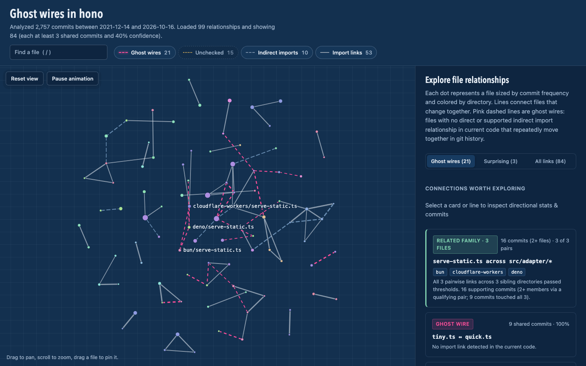
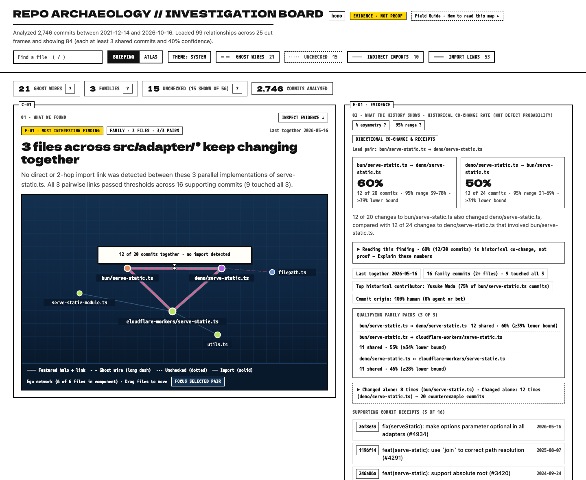

# <picture><source media="(prefers-color-scheme: dark)" srcset="https://raw.githubusercontent.com/lbrodie11/repo-archaeology/main/docs/brand/icon-dark.svg"></picture> Repo Archaeology

[](https://github.com/lbrodie11/repo-archaeology/actions/workflows/ci.yml)
[](https://www.npmjs.com/package/repo-archaeology)
[](https://github.com/lbrodie11/repo-archaeology/blob/main/LICENSE)
[](https://github.com/lbrodie11/repo-archaeology/blob/main/package.json)

**Your codebase remembers relationships your imports don't show.**
Repo Archaeology mines your Git history to find files that repeatedly change together—even when no import connects them—and shows you the commits behind them.

A repository tells two stories. The source tree says what depends on what. Git history records what people have learned to change together.

Repo Archaeology compares those stories. It finds **ghost wires**: files that repeatedly change together even though Repo Archaeology finds no direct or supported indirect import relationship between them in the current code. It surfaces the commits behind each link, suggests companion files a change may have overlooked, and offers cautious explanations when both files reference the same rare environment variable, API route, or event name.

Analysis runs entirely locally against your `.git` repository. Once installed or fetched via `npx`, Repo Archaeology operates offline—no accounts, no telemetry, and no code uploads.



*The interactive map on [honojs/hono](https://github.com/honojs/hono), generated locally with default thresholds (`npx repo-archaeology map`; pass `--style rich` for the FRAME/12 Investigation Board + Atlas view).*

**Not just shared commit counts:** Repo Archaeology measures how often each file changes, ranks relationships by statistical evidence, and filters out common sources of noisy Git history.

## Quick start

Requires Node.js 22+ and Git 2.24+. Run it inside any Git repository:

```bash
# Explore your current Git repository (checks changed files or shows top findings)
npx repo-archaeology

# Open the interactive visual map
npx repo-archaeology map

# Check potentially overlooked companion files for staged/working changes
npx repo-archaeology diff

# Show all options and subcommands
npx repo-archaeology --help
```

Or install it globally:

```bash
npm install -g repo-archaeology
```

## How Repo Archaeology avoids misleading results

Two files changing together doesn't necessarily mean they're connected. Repo Archaeology uses several safeguards to separate meaningful patterns from coincidental changes.

### 1. It considers how often each file changes

Imagine `auth.ts` and `permissions.ts` changed together in 9 commits. That number alone doesn't tell the whole story:

| Historical behavior | Result |
| --- | --- |
| `auth.ts` changed 12 times, and `permissions.ts` changed alongside it 9 times | **75%** |
| `permissions.ts` changed 30 times, and `auth.ts` changed alongside it 9 times | **30%** |

Both directions matter. Repo Archaeology calculates these percentages separately, shows the two-sided 95% Wilson confidence interval alongside each count, and uses the Wilson score lower bound when ranking findings. That means a relationship based on 3 shared changes out of 3 doesn't automatically outrank one backed by 40 out of 50.

By default, findings require at least **3 shared commits** and **40% directional confidence**.

### 2. It filters out common sources of noise

Large formatting operations, generated files, and automated maintenance can make unrelated files appear connected. Repo Archaeology reduces this noise automatically:

- **Large commits:** Skips commits touching more than 25 files by default.
- **Generated artifacts:** Ignores common lockfiles, build output, snapshots, changelogs, and minified bundles.
- **Mechanical reverts:** Skips `git revert` commits (`Revert "..."`) so a change and its revert are not double-counted as two separate co-change observations.
- **Custom exclusions:** Lets you exclude additional files (`--ignore`) and commits matching specific subject patterns (`--skip-commits` or `.repo-archaeology.json`).
- **Single-file changes:** Keeps them in the history so relationship percentages aren't artificially inflated.

You can customize these protections:

```bash
# Ignore commits touching more than 15 files
npx repo-archaeology scan --max-files 15

# Exclude commits whose subject begins with "style:"
npx repo-archaeology scan --skip-commits '^style:'
```

These safeguards reduce false positives, but cannot eliminate them entirely. For example, a smaller formatting-only commit may still contribute to a relationship if it touches 25 or fewer files and doesn't match your subject filters. Every finding is a historical clue, not proof of a dependency—you can inspect the supporting commits and diffs (`explain`) to decide whether the relationship matters.

## Real-world workflows

### 1. Explore an unfamiliar codebase visually (`map`)

Joining a new project with hundreds of files? You can trace explicit imports, but you don't yet know which modules developers usually modify together or where hidden coupling lives.

Generate a self-contained, offline interactive map in one command:

```bash
$ npx repo-archaeology map
# Writes an offline HTML report to .git/repo-archaeology/map.html and opens it in your browser.
# Pass --style rich for the FRAME/12 Investigation Board (Briefing + Atlas + Field Guide).
```

In the default `classic` view, files are colored by folder and sized by churn, and pink dashed lines mark **ghost wires**—files that co-evolve without direct or indirect imports. In `--style rich`, the report opens to the **FRAME/12 Investigation Board (`Briefing`)**: a plain-English headline for the repository's top finding or parallel-implementation family (`C-01`), a 3-beat reading guide, a cyanotype ego-network blueprint plate with speech-balloon callout, side-by-side directional evidence and commit receipts (`E-01`), secondary finding cards (`C-02`–`C-04`), a filterable Ranked Findings index (`C-05`), a built-in **Field Guide** (glossary, worked interpretation of the active finding, and path-redacted analysis provenance), and a one-click toggle to the full **contact-sheet `Atlas`** (`C-01`, `C-02`… component frames) with light/dark ink-and-paper themes. Click any file, wire, or card to inspect the exact shared commits behind the link.

### 2. Catch companion files when editing or reviewing a PR (`diff`)

You fix a bug or add an option to `src/adapter/bun/serve-static.ts`. Did you remember that sibling adapters often require the same update?

`diff` checks the co-change history of the files in your working tree (or on your branch with `--base main`) and highlights companion files that haven't been touched:

```text
$ npx repo-archaeology diff --base main

Repo Archaeology · diff (main...HEAD + uncommitted changes)
2,757 commits analyzed from 2021-12-14 to 2026-10-16, 34 sweeping commits skipped

You changed 1 file.

Finding families (1)
  serve-static.ts across src/adapter/* — changed src/adapter/bun/serve-static.ts; check src/adapter/cloudflare-workers/serve-static.ts, src/adapter/deno/serve-static.ts (all 3 pairwise links met thresholds · 16 supporting commits (2+ members via a qualifying pair))

Possibly missed (3)

  src/adapter/deno/serve-static.ts  ghost wire
    changed with src/adapter/bun/serve-static.ts in 12 of 20 commits (60%) (95% CI 38–79%) · last together 5 months ago
    possible parallel implementations: serve-static.ts appears in sibling folders
    26f8c33 2026-05-16  fix(serveStatic): make options parameter optional in all adapters (#4934)
    1196f14 2025-08-07  feat(serve-static): use `join` to correct path resolution (#4291)
    246a06a 2024-09-24  feat(serve-static): support absolute root (#3420)

  src/adapter/cloudflare-workers/serve-static.ts  ghost wire
    changed with src/adapter/bun/serve-static.ts in 11 of 20 commits (55%) (95% CI 34–75%) · last together 5 months ago
    possible parallel implementations: serve-static.ts appears in sibling folders

  runtime-tests/bun/index.test.tsx  test link
    changed with src/adapter/bun/serve-static.ts in 10 of 20 commits (50%) (95% CI 29–71%) · last together 14 months ago
    a test that changes with this code
```

*(Verified output from [honojs/hono](https://github.com/honojs/hono) at `08807ce1` after editing the Bun adapter.)*

**The decision it prompts:** Parallel implementations aren't bugs—they're expected sibling patterns. `diff` gives you the commit evidence so you can review the other adapters and decide whether the new behavior should stay consistent across platforms.

### 3. Audit hidden architectural coupling across modules (`scan`)

Two files in different modules keep changing together, even though neither directly imports the other and there is no one-step indirect import between them.

Run `scan` to audit hidden coupling and ghost wires across your entire repository:

```text
$ npx repo-archaeology scan

Repo Archaeology · scan
2,757 commits analyzed from 2021-12-14 to 2026-10-16, 34 sweeping commits skipped

342 relationships above the thresholds: 21 ghost wire · 56 unchecked · 10 indirect import · 53 import link · 202 test link
Showing ghost wire, unchecked. Change with --kinds ghost,unknown,indirect,direct,test.

Finding families (3)

 1. serve-static.ts across src/adapter/*  3 related implementations · ghost wire
    members: bun · cloudflare-workers · deno
    16 supporting commits (2+ members via a qualifying pair) · 9 commits touched all 3 · all 3 pairwise links met thresholds · last together 5 months ago
    26f8c33 2026-05-16  fix(serveStatic): make options parameter optional in all adapters (#4934) [all 3 members]
    1196f14 2025-08-07  feat(serve-static): use `join` to correct path resolution (#4291) [2 of 3 members]
    246a06a 2024-09-24  feat(serve-static): support absolute root (#3420) [2 of 3 members]

Individual relationships (15)

 1. src/preset/tiny.ts → src/preset/quick.ts  ghost wire
    when src/preset/tiny.ts changed, src/preset/quick.ts changed too in 9 of 9 commits (100%) (95% CI 70–100%) · last together 2.4 years ago
    reverse: 90% · no import link detected in the current code

 2. src/helper/streaming/stream.ts → src/helper/streaming/sse.ts  ghost wire
    when src/helper/streaming/stream.ts changed, src/helper/streaming/sse.ts changed too in 7 of 8 commits (87%) (95% CI 52–98%) · last together 1.7 years ago
    reverse: 38% · no import link detected in the current code
```

When three or more sibling parallel implementations (across sibling directories like `src/adapter/*/serve-static.ts`, or 3+ files in the same directory sharing a descriptive hyphenated suffix like `*-picker.tsx`) form a connected co-change group, `scan` summarizes them under **Finding families** above the individual pairs, distinguishing complete families from partial connected components. Repo Archaeology also inspects TypeScript ASTs for shared environment variables, event names, or route patterns to give you evidence of why files might be coupled.

## Commands

| Command | What it answers |
| --- | --- |
| `repo-archaeology` | If files changed, what might be missing? If clean, what are the strongest hidden relationships? |
| `scan` | Which files in this repo are secretly coupled? |
| `diff [--base main]` | I changed these files. What usually changes with them that I haven't touched? |
| `explain <fileA> <fileB>` | What actually changed in the commits these two files share, and when did one change without the other? |
| `file <path>` | What does history know about this file: churn, owners, companions? |
| `map` | Show me the whole picture as an interactive map in the browser (`--style classic` or `--style rich`). |
| `backtest` | How often would these suggestions have been right on recent history? |
| `imports [--files <path>...]` | What does the internal JS/TS import graph look like, and which files import these targets? |
| `verdict add\|list\|prune` | Silence expected mechanical relationships or annotate confirmed hidden dependencies in `.repo-archaeology.verdicts.json`. |

Every command accepts `--json` (`schemaVersion: 1`; see [docs/json.md](docs/json.md) and [`schema/`](schema) for the formal JSON Schema contract). Run `repo-archaeology --help` for all options.

### `diff`

Looks at staged, unstaged and untracked changes (renames included). With `--base main`, it also includes the commits on your branch since it forked from `main`, so it works as a pre-PR check. When `--base <ref>` is passed, co-change history is trained strictly at the merge-base (`git merge-base HEAD <ref>`) rather than `HEAD`, preventing commits already on your feature branch from self-reinforcing baseline statistics while still bridging branch-local renames.

When three or more sibling parallel implementations form a connected co-change group and your change touches part of the family, `diff` surfaces a **Finding families** summary (`changed …; check …`) above the individual pairwise suggestions. If `diff` finds changed files in history but zero suggestions pass thresholds, it prints a `"No suggestions after evaluating …"` breakdown showing why (for example, files are new or only appeared in skipped sweep commits, all historical companions are already in your change, or the closest companions fell below `--min-shared` or `--min-confidence`).

Use `--format markdown` to render a GitHub-Flavored Markdown pull request summary to `stdout`, and `--json-out <file>` to simultaneously write the versioned `schemaVersion: 1` JSON report to a file in the same single history pass:

```bash
repo-archaeology diff --base main
repo-archaeology diff --base main --owners
repo-archaeology diff --base main --format markdown --json-out diff.json
repo-archaeology diff --exit-code   # exit 1 when something looks missed (for hooks/CI)
```

Pass `--owners` (or set `"owners": { "enabled": true }` in `.repo-archaeology.json`; override with `--no-owners`) to enrich each suggested companion file with **People who may have context** (up to `owners.max` recent human contributors within `owners.lookbackDays`, canonicalized via `.mailmap` and excluding bots/non-human agents, without exposing email addresses) and **Designated code owners** from `.github/CODEOWNERS`, `CODEOWNERS`, or `docs/CODEOWNERS` (read from `merge-base` when `--base` is used, and rendered with a zero-width break after `@` so copying output into a PR comment never pings teammates).

### GitHub Action (Pull Request Summaries)

Repo Archaeology ships an official composite GitHub Action (`action.yml`) that writes a quiet, non-blocking Markdown summary to `$GITHUB_STEP_SUMMARY` on pull requests—requiring only `contents: read` permissions and zero PR comment spam:

```yaml
name: Repo Archaeology

on:
  pull_request:

permissions:
  contents: read

jobs:
  archaeology:
    runs-on: ubuntu-latest
    steps:
      - uses: actions/checkout@v5
        with:
          # Check out the exact PR head commit with full history for merge-base training
          ref: ${{ github.event.pull_request.head.sha }}
          fetch-depth: 0
          persist-credentials: false

      - uses: actions/setup-node@v5
        with:
          node-version: 22

      - name: Check for overlooked companion files
        id: archaeology
        uses: lbrodie11/repo-archaeology@v0.5.1
        with:
          base: ${{ github.event.pull_request.base.sha }}
          head: ${{ github.event.pull_request.head.sha }}
          limit: '5'
          fail-on-suggestions: 'false'
```

**Action inputs & outputs:**
- **Inputs:** `base` (default `${{ github.event.pull_request.base.sha }}`), `head` (default `${{ github.event.pull_request.head.sha }}`), `limit` (default `'5'`), `min-shared`, `min-confidence`, `kinds`, `working-directory` (default `'.'`), and `fail-on-suggestions` (default `'false'`).
- **Outputs:** `suggestion-count` (total qualifying suggestions before `--limit`), `uncommitted-files-count` (number of dirty working-tree files included in the analysis; `0` when clean), `json-path` (path to the `schemaVersion: 1` JSON artifact on the runner), and `analysis-status` (`analyzed`, `insufficient-history`, or `skipped`).
- **Checkout & environment notes:**
  - Always set `fetch-depth: 0` on `actions/checkout`. If a clone is shallow (`git rev-parse --is-shallow-repository`) or has fewer than 2 commits, the Action degrades gracefully (`analysis-status: insufficient-history`, exit code `0`) and explains how to enable full history in `$GITHUB_STEP_SUMMARY`.
  - Set `ref: ${{ github.event.pull_request.head.sha }}` on `actions/checkout` so Git checks out the PR's real head commit rather than GitHub's synthetic merge ref (`refs/pull/:id/merge`). The Action verifies `HEAD` against `head` so it never silently analyzes the wrong commit.
  - **Dirty working-tree warning:** If an earlier workflow step modifies tracked files or creates untracked files before the Action runs, the Action warns in `$GITHUB_STEP_SUMMARY`, emits a `::warning::` annotation, and sets `uncommitted-files-count`.
  - **Pinned external execution (`action.yml`):** When used from another repository (`uses: lbrodie11/repo-archaeology@v0.5.1`), release tags intentionally omit `dist/` from git; `action.yml` runs `src/action/runner.ts` via Node 22's `--experimental-strip-types`, which installs and executes the exact pinned npm version `repo-archaeology@0.5.1` (`PINNED_ACTION_PACKAGE` matching `package.json`, never `latest` and never the consumer repository's working tree) inside an isolated temporary directory outside `$GITHUB_WORKSPACE`.
  - **Private registries / mirrors:** When running as an external consumer action, user-level npm configuration created outside `$GITHUB_WORKSPACE` (such as `NPM_CONFIG_USERCONFIG` from `actions/setup-node` with `registry-url`, or `~/.npmrc` on self-hosted runners) is resolved to its canonical absolute path and honoured, while repository-controlled `.npmrc` files inside `$GITHUB_WORKSPACE` are isolated into separate empty config files. You can also pass `npm_config_registry` in the step's `env:` as an explicit override.
  - **Post-release consumer smoke test:** Maintainers can trigger `.github/workflows/action-smoke.yml` manually via `workflow_dispatch` (passing `tag: v0.5.1`) or automatically after `Release` completes to verify the unbuilt external consumer path across Linux and Windows (setting `REPO_ARCHAEOLOGY_SUMMARY_OUT` when a test workflow needs a copy of the rendered step summary).

### `explain`

Inspects bounded Git diff hunks for two files across their most recent shared commits (following historical paths across renames) and lists recent counterexample commits where one file changed without the other:

```bash
repo-archaeology explain src/adapter/bun/serve-static.ts src/adapter/deno/serve-static.ts
repo-archaeology explain <fileA> <fileB> --commits 5 --counterexamples -U 3
```

Historical patches show what changed in the same commit, not proof of why the files changed together or that future edits require both files.

### `map`

Writes a single self-contained HTML file (no network requests, works offline) with a precomputed, deterministic layout so it opens immediately to a settled graph with zero idle work. Click a file or wire to see directional co-change rates, shared commits, counterexample commits where one file changed without the other, and a copyable `npx repo-archaeology explain <fileA> <fileB>` command. When three or more sibling parallel implementations move together, the overview groups **finding families** into unified cards with member coverage, supporting commit counts (`2+ files` vs `all N`), active filter updates, and per-pair inspection (including undrawn pairs when capped or filtered).

`map` supports two visual styles via `--style <classic|rich>`, `REPO_ARCHAEOLOGY_STYLE=rich`, or `"style": "rich"` in `.repo-archaeology.json` (precedence: `flag > env > config > default "classic"`):
- **`classic` (default):** A global force-directed graph where files are dots sized by churn and coloured by folder, and ghost wires are pink dashed lines (static when unfocused, and marching at 12 fps when hovered or selected).
- **`rich` (opt-in `--style rich`):** A FRAME/12 **Investigation Board (`Briefing`) + contact-sheet `Atlas`** report (`Briefing | Atlas` view toggle) with FRAME/12 ink/paper light and dark themes (`Theme: System / Light / Dark`) and embedded offline `Dela Gothic One` and `M PLUS 1 Code` fonts. **Briefing** opens with a repository stat strip (with inline `?` glossary popovers), a 3-beat plain-language guide, the lead finding or Finding Family in Cut `C-01` (`760×420` desktop / `340×240` mobile interactive cyanotype ego-network blueprint plate with draggable file nodes, pan/wheel-zoom, a `Focus selected pair` toggle, chord pruning with a hidden-chord disclosure on dense cliques, speech-balloon callout, and chalk-halo ghost wires), a `Reading This Finding` worked statistical explanation (including unnamed single-contributor habit caveats when one human author made `≥60%` of commits), directional co-change cards with a plain-language asymmetry sentence and commit receipts in `E-01`, secondary finding cards (`C-02`–`C-04`), a Ranked Findings index (`C-05`) with 95% Wilson confidence screentone bars and `#f=<sourcePath>..<targetPath>` deep links, and a collapsible **Field Guide** (`Start Here`, 12-term `Glossary`, and path-redacted `About This Analysis` provenance). **Atlas** places each connected component in its own cut-numbered frame (`C-01`, `C-02`…) ordered by priority on a 12-column grid with SVG line-pattern swatches (distinguishable without color), stroke width scaled by the 95% Wilson confidence lower bound (`interval.low`) with explicit `weak` markers when `interval.low < 0.30`, and synchronized selection with Briefing. It uses the same `--style rich` flag and shared `src/style/frame12.ts` color palette as the rich terminal output (`RA-13`), and both styles share byte-identical `#ra-data`, Markdown export, and `--json` output (see [docs/map-hallway-test.md](docs/map-hallway-test.md) for the evaluation protocol).

<picture>
  <source media="(prefers-color-scheme: dark)" srcset="https://raw.githubusercontent.com/lbrodie11/repo-archaeology/main/docs/repo-archaeology-map-rich-dark.png">
  
</picture>

*The opt-in FRAME/12 Investigation Board (`Briefing` + `Atlas` + `Field Guide`) view on [honojs/hono](https://github.com/honojs/hono) (`npx repo-archaeology map --style rich`), automatically adapting between paper (light) and ink (dark) themes.*

By default the map is written to `.git/repo-archaeology/map.html`, which is never committed. Use `--out` to put it elsewhere. **Privacy when sharing:** source-code patches are omitted by default, but the HTML still contains repository file paths, author names, and commit subjects—treat it like repository metadata when sharing. Pass `--include-patches` (`repo-archaeology map --include-patches`) to embed bounded diff hunks for top relationships directly into the HTML file; because `--include-patches` embeds source-code lines, only share those reports with audiences who have access to the source code.

The overview prioritizes pairs that changed together within the past year and meet `--min-confidence` in both directions. Independent folders receive priority over parent/child folders and possible parallel implementations. Wilson score orders findings within each group. This is a discovery heuristic, not a risk score; older and one-way links remain available, and `diff` ranking is unchanged.

Unsupported code/schema pairs remain **unchecked**, not proven ghost wires. `diff` includes these by default. Use `map --kinds unknown` or `scan --kinds unknown` to inspect them without the default unchecked cap.

### `backtest`

Learns from older commits only, then replays newer ones one changed file at a time and checks whether the suggestions were among the files that really changed. It compares against a "guess the most popular files" baseline scored on the same changes.

```text
strategy                   speaks up   hit@3   precision   false alarms   recall
co-change                        65%     64%         37%            36%      13%
popularity, same changes         65%     13%          5%            87%       3%
```

Use it to choose thresholds for your repo. To avoid fooling yourself, tune with `--before <date>` (an older window) and look at the final score once without it.

`repo-archaeology backtest --ghosts` adds a diagnostic breakdown of the original top-k suggestions that are ghost wires in today's working tree. It reports raw query/suggestion counts, hit rate and precision without altering the main scores. **Current imports leak future information**, including with `--before`; missing current files are excluded. This is neither an unbiased historical ghost-accuracy estimate nor a simulation of filtering to ghosts before ranking.

`repo-archaeology backtest --follow-ups [--follow-up-window <hours>]` evaluates multi-commit omissions by checking whether files suggested for a commit were untouched in that commit, then subsequently modified by the same author within the time window (`48` hours by default) in a commit that either shares a modified file with the original commit or is immediately consecutive. Subject cues (`fix`/`fixed`/`fixup`, `forgot`, `missed`/`missing`, `follow-up`, `oops`, `amend`, `repair`, `patch`, `sync`, `companion`) are reported as an optional signal label (`subject-cue`), not a requirement. Follow-up matches are heuristic proxies for multi-commit follow-ups, not proof of prevented bugs.

### Analyze a past commit (`--head <ref>`)

Pass `--head <ref>` to run any command (`scan`, `diff`, `file`, `explain`, `backtest`, or `map`) as if `<ref>` were checked out, without touching `HEAD`, `.git/index`, or your working tree. History is restricted to ancestors of `<ref>`, `.repo-archaeology.json` is loaded from `<ref>`'s tree (with CLI flags retaining precedence), current files come from `git ls-tree <ref>`, and import classification reads regular-file blobs from `<ref>` via a single `git cat-file --batch` session:

```bash
# Replay a historical pull request at its exact head and base commits
repo-archaeology diff --head <sha> --base <sha>

# Run a chronological holdout backtest as of a past release tag
repo-archaeology backtest --head v1.2.0
```

`diff --head <ref>` requires `--base <ref>`, and bare `repo-archaeology --head <ref>` runs `scan` at `<ref>`. When `--head <ref>` resolves to the currently checked-out `HEAD` on a dirty working tree, uncommitted changes and untracked files are ignored and a warning is recorded in `meta.warnings` (`"Working tree has uncommitted changes; uncommitted changes were ignored because --head was specified."`). If `<ref>` contains a `.repo-archaeology.json` that the current version rejects, Repo Archaeology falls back to the working-tree configuration and records a warning in `meta.warnings`. JSON outputs include `meta.head: { ref, sha }`.

### Library API (`openRepository`) & `imports`

Use the programmatic ESM entry point (`import { openRepository } from 'repo-archaeology'`) to load a repository's Git history once and run multiple analyses (`diff`, `scan`, `file`, `explain`, `backtest`, and `importGraph`) in a single session without spawning subprocesses. Every `Repository` method returns the exact `schemaVersion: 1` object printed by the CLI with `--json`.

```ts
import { openRepository } from 'repo-archaeology';

const repo = await openRepository({ cwd: '/path/to/repo', head: prHeadSha, base: prBaseSha });
try {
  const [diffJson, backtestJson, importsJson] = await Promise.all([
    repo.diff({ limit: 10 }),
    repo.backtest(),
    repo.importGraph({ files: ['src/api.ts'] }),
  ]);
} finally {
  await repo.close();
}
```

You can also inspect internal JavaScript/TypeScript import edges from the CLI via `repo-archaeology imports [--files <path>...] [--json]` (validated against [`schema/import-graph.schema.json`](schema/import-graph.schema.json)). See [`docs/api.md`](docs/api.md) for the full library reference, TypeScript exports, and stability policy.

## How to read the results

Every relationship has a kind:

| Kind | Meaning |
| --- | --- |
| **ghost wire** | No import link was detected between the files in the current code, not even one step removed, yet they change together. The interesting one. |
| **indirect import** | No direct import, but one file imports a file that imports the other (for example `hono.ts → hono-base.ts → compose.ts`). The coupling is visible in the code, one step removed. |
| **import link** | One imports or explicitly path-references the other, directly or through an index/barrel file. A type reference is not a runtime import. |
| **test link** | A test changing with code, or tests changing together. Expected. |
| **unchecked** | We could not check dependencies fully: non-JS/TS files, project config such as `package.json`, unresolved imports or path references, or dynamic loads whose target is computed at runtime (`import(name)`, `require(name)`, `import.meta.glob`). |

**Confidence is directional.** "When `a.ts` changed, `b.ts` changed too in 9 of 12 commits (75%)" says nothing about how often `a.ts` changes when `b.ts` does; that number is shown as *reverse*.

**Results are ranked by evidence**, not just by percentage: 3 out of 3 ranks below 40 out of 50 (Wilson score lower bound).

**It is a historical signal, not proof.** Two files changing together in the past does not mean your change needs both.

**Hidden bridges are possible explanations, not diagnoses.** For JS/TS files, Repo Archaeology recognizes possible parallel implementations in sibling folders and walks the TypeScript syntax tree for shared environment variables, `/api/...` route strings, event names used in event-method calls, and explicit named exports. Reference signals are shown only when at most three current, non-ignored source files use them. A shared export name suggests a possible public contract, not identical behavior; private, default, wildcard and nested namespace exports are not inferred. Without a recognized signal, the tool says only that no import link was detected in the current code.

## When Repo Archaeology won't help

Being upfront about limitations builds trust. Repo Archaeology is designed for specific kinds of codebases and questions:

* **Young repositories or large squash commits**: If a repository has fewer than ~50 commits, or was migrated via large monolithic commits, there is insufficient co-change history to surface reliable patterns.
* **Code you wrote yesterday**: If you just authored or refactored a module, you already carry its mental model in fresh memory. Repo Archaeology is most valuable for older work where context has faded, *other people's* code, new teammates, and pull request reviews.
* **Coupling outside Git's view**: Cross-repository dependencies, database schema migrations, and external API contracts are invisible to a single repository's Git history.
* **Non-JavaScript/TypeScript import verification**: All file types participate in Git co-change history, but AST analysis and import checking currently support JS/TS only. Other file types (Go, Python, Rust, CSS, YAML) are classified as **unchecked**, not verified ghost wires.
* **Historical clues, not proof of omission**: Co-change history indicates that files have frequently changed together in the past. It is a clue to guide review, not proof that an untouched file must change.

## Options

Global options work with every command:

| Option | Default | Meaning |
| --- | --- | --- |
| `--min-shared <n>` | 3 | Minimum commits two files must share |
| `--min-confidence <p>` | 0.4 | Minimum directional confidence (`0.4` or `40%`) |
| `--max-commits <n>` | 5000 | Most recent non-merge commits to read |
| `--since <date>` | | Only commits after this date (`"2 years ago"`, `2024-01-01`) |
| `--max-files <n>` | 25 | Commits touching more files are treated as sweeps (formatting, mass renames) and skipped |
| `--ignore <glob>` | | Ignore matching files (repeatable) |
| `--no-default-ignores` | | Keep lockfiles, build output, snapshots and changelogs |
| `--skip-commits <regex>` | | Skip commits whose subject matches, e.g. `"^(chore\|style)\b"` |
| `--include-reverts` | `false` | Include mechanical `git revert` and `Reapply` commits (`Revert "…"` and `Reapply "…"`, skipped by default and counted in `meta.revertsSkipped`) |
| `--half-life <days>` | | Weight recent commits more |
| `--head <ref>` | | Analyze repository at `<ref>` without checking it out |
| `--origin-weights <spec>` | `human=1,agent=1,bot=1` | Weight commits by origin, e.g. `bot=0,agent=0.5` (values in `[0, 1]`) |
| `--style <mode>` | `classic` | Visual style for terminal output and `map`: `classic` (default) or `rich` (FRAME/12 editorial terminal hierarchy and Investigation Board + Atlas map; also settable via `REPO_ARCHAEOLOGY_STYLE` for personal preference, or `"style"` in `.repo-archaeology.json` as a team-wide default) |
| `--ascii` | | Use ASCII-only box rules, arrows, and separators in `--style rich` output |
| `--no-links` | | Disable OSC 8 clickable commit-receipt hyperlinks in `--style rich` output |
| `--full-evidence` | | Inline all supporting commit receipts without an `Additional receipts` split in `--style rich` output |
| `--owners` / `--no-owners` | `false` | Enrich `diff` suggestions with recent human contributor context and `CODEOWNERS` handles |
| `--no-cache` | | Neither read nor write the [history cache](#history-cache) |
| `-C, --cwd <path>` | | Run as if started in `<path>` |

Settings can also live in `.repo-archaeology.json` at the repository root (flags win). Note that `"style"` in `.repo-archaeology.json` sets a repository-wide default for every contributor (overridable via `REPO_ARCHAEOLOGY_STYLE=classic` or `--style classic`); for a personal terminal preference, export `REPO_ARCHAEOLOGY_STYLE=rich` in your shell profile instead:

```json
{
  "minShared": 3,
  "minConfidence": 0.4,
  "maxFilesPerCommit": 25,
  "ignore": ["docs/generated/", "*.pb.go"],
  "skipCommitPrefixes": ["chore", "deps"],
  "skipCommits": "^chore\\(deps\\)",
  "skipReverts": true,
  "owners": {
    "enabled": false,
    "max": 3,
    "lookbackDays": 365,
    "maxCommits": 100
  }
}
```

The config file is part of the repository, so it is treated as untrusted input: it must be a small regular file, `maxFilesPerCommit` is capped at 1000, and `skipCommits` patterns that can backtrack catastrophically (quantifiers vulnerable to polynomial/exponential ReDoS, repeated groups with alternation, or backreferences) are refused. For safe prefix-based skipping without regexes, use `skipCommitPrefixes`. Command-line flags are not restricted.

## History cache

Reading history (`git log --name-status` over up to `--max-commits` commits) is the slowest part of every run. Repo Archaeology therefore keeps the **raw, settings-independent** parsed commit records on disk, keyed by commit hash, and on each run parses only the commits the cache does not have yet. Filtering (`--max-files`, ignores, `--skip-commits`, `--since`) still happens after the cache, so one cache serves every setting, every `--head`, and every branch. Cached and `--no-cache` runs produce identical results; only the optional `meta.cache` field differs.

- **Location & plain-text metadata:** `<git-common-dir>/repo-archaeology/cache/` (normally `.git/repo-archaeology/cache/`, shared by all worktrees). It is never committed, and creates a `.gitignore` (`*`) inside the cache directory so custom in-repository locations never pollute `git status`. Cache segments store commit metadata (`hash`, `authorName`, `authorEmail`, timestamps, commit subjects, trailers, and changed file paths) in plain text under `.git`; run `rm -rf .git/repo-archaeology` at any time to reset and delete it.
- **Override:** set `REPO_ARCHAEOLOGY_CACHE_DIR` (any path; relative paths resolve against the current directory), or `"cache": { "dir": "…" }` in `.repo-archaeology.json` (must be an untracked relative path inside the repository without `..` or symlink traversal, because the config file is untrusted). The environment variable wins over the config file.
- **Disable:** pass `--no-cache`, or set `"cache": { "enabled": false }`. In the library API, pass `settings: { cache: { enabled: false } }`.
- **Safety & invalidation:** the cache only writes into an empty directory or one it has tagged with `CACHEDIR.TAG` (using `0700` directory and `0600` file permissions where supported), so a mistyped directory can never clobber other files. Each segment is written to a temp file and atomically renamed; `index.json` records a SHA-256 per segment plus `cacheVersion`, `gitVersion`, and a `formatSignature` covering `FORMAT`, diff flags, trailer limits, and Git config overrides (`raVersion` patch bumps do not discard cached records). A corrupt segment, a checksum mismatch, a changed git version, or a format-signature change discards and rebuilds the cache with a warning in `meta.warnings`. Concurrent runs are safe: writers take an exclusive token-verified lock file (abandoned after 60 s), and a run that cannot take the lock simply skips saving.
- **Shallow clones:** the cache is read but never written (the history is incomplete), commits at the shallow boundary are always re-parsed, and a warning is added.
- **Size:** more than 20 segments or 200 MB triggers compaction into one segment, which also drops commits no longer reachable from any ref.
- **Observability:** JSON output includes `meta.cache: { enabled, hits, misses, dir? }`, where `dir` is relative to the repository root (or `"$REPO_ARCHAEOLOGY_CACHE_DIR"` when set by the environment variable) and never absolute.

### Reusing the cache in GitHub Actions (`actions/cache`)

CI checkouts start empty, so you can optionally point the cache at a directory that `actions/cache` restores. Use `fetch-depth: 0`: in shallow clones the cache is read-only.

> **Privacy & CI security note:** Cache segments store commit metadata from your repository (`hash`, `authorName`, `authorEmail`, timestamps, subjects, trailers, and changed file paths). Keep `actions/cache` explicit in your workflow, scope keys by branch (`github.ref_name`) with `restore-keys` fallback, and do not grant cache write access to untrusted fork pull requests (`pull_request_target`).

```yaml
jobs:
  ghost-wires:
    runs-on: ubuntu-latest
    env:
      REPO_ARCHAEOLOGY_CACHE_DIR: ${{ runner.temp }}/repo-archaeology-cache
    steps:
      - uses: actions/checkout@v4
        with:
          fetch-depth: 0
      - uses: actions/cache@v4
        with:
          path: ${{ runner.temp }}/repo-archaeology-cache
          # Immutable per-SHA key with branch-scoped restore fallback.
          key: repo-archaeology-v1-${{ runner.os }}-${{ github.ref_name }}-${{ github.sha }}
          restore-keys: |
            repo-archaeology-v1-${{ runner.os }}-${{ github.ref_name }}-
            repo-archaeology-v1-${{ runner.os }}-
      - run: npx repo-archaeology diff --base origin/${{ github.base_ref }} --json > ghost-wires.json
```

## Relationship verdicts (`.repo-archaeology.verdicts.json`)

Teams can commit `<repoRoot>/.repo-archaeology.verdicts.json` (validated against [`schema/verdicts.schema.json`](schema/verdicts.schema.json)) to silence known mechanical relationships (`"verdict": "expected"`) or annotate real hidden dependencies (`"verdict": "confirmed"`) **without altering underlying historical scores, counts, confidence, Wilson intervals, or `backtest` accuracy**:

```json
{
  "version": 1,
  "verdicts": [
    {
      "pair": ["package.json", "package-lock.json"],
      "verdict": "expected",
      "reason": "Lockfile always moves with package.json",
      "until": "2027-01-01",
      "by": "lbrodie11",
      "directed": false
    },
    {
      "pair": ["src/billing/charge.ts", "db/schema.sql"],
      "verdict": "confirmed",
      "reason": "Charge writes the orders table directly; keep in sync",
      "by": "lbrodie11"
    }
  ]
}
```

```bash
# Silence a known mechanical pair (with optional expiration and author)
npx repo-archaeology verdict add package.json package-lock.json --expected --reason "Lockfile always moves with package.json" --until 2027-01-01 --by lbrodie11

# Annotate a confirmed hidden dependency
npx repo-archaeology verdict add src/billing/charge.ts db/schema.sql --confirmed --reason "Charge writes the orders table directly; keep in sync" --by lbrodie11

# List active and expired verdicts, or remove expired entries
npx repo-archaeology verdict list
npx repo-archaeology verdict prune

# Include silenced (expected) relationships in scan, file, or map
npx repo-archaeology scan --show-silenced
```

- **How verdicts behave:**
  - **`diff` & GitHub Action:** `expected` pairs are filtered out of `suggestions` and `families` (including family completion) and counted in `verdicts: { silenced: N }` (and in `silence.verdicts: { silenced: N }` with `silence.primaryReason: "silenced_by_verdicts"` when all qualifying candidates were silenced). `confirmed` pairs stay in `suggestions` with their `verdict` annotation rendered in terminal and Markdown output.
  - **`diff --base` self-silencing protection:** When `diff` runs with `--base <ref>`, active verdicts are loaded from the `<merge-base>` commit tree by default so a pull request cannot silence warnings about itself before merging. Verdict entries added or modified on the branch are reported in `verdicts.addedInBranch` and in Markdown/terminal output (`"This PR adds N expected verdict(s) (not applied until merged)"`). Pass `--apply-branch-verdicts` for local preview before merging.
  - **`scan`, `file`, and `map`:** `expected` pairs are hidden by default (and counted in `verdicts: { silenced: N }` in JSON plus a dim `(N silenced by verdicts; use --show-silenced)` line in terminal output) unless `--show-silenced` is passed; `confirmed` pairs (and `expected` pairs with `--show-silenced`) include their `verdict` annotation.
  - **`explain`:** Always explains the requested pair and displays its `verdict` annotation when one matches.
  - **Specificity, precedence & expiration:** Catch-all globs where both endpoints match every file (such as `["**", "**"]` or `["*", "**"]`) are rejected; at least one endpoint must be an exact path or a glob with a fixed directory prefix or file extension. When multiple active verdicts match a pair, more specific endpoints win over broader globs, `directed: true` wins over undirected at equal path specificity, and `"confirmed"` wins over `"expected"` at equal specificity, independent of file order. `until` (`YYYY-MM-DD`) is an inclusive UTC date (`until >= today` in UTC is active; `until < today` is expired and emits a warning in `meta.warnings`).
  - **Renames vs. globs:** Exact (non-glob) verdict paths are resolved through `RenameTracker` / `History` identities and active branch/working-tree renames (including multi-hop intermediate branch renames and preserving separate file identities when a rename reuses a vacated path), so a verdict on `a.ts` continues to apply after `git mv a.ts b.ts`. Glob verdicts (using `*`, `**`, `?`, `{a,b}`, or trailing `/`; literal `[id]` or `{id}` path segments are treated as exact paths) match current paths only.

## Bots and agents

Automated dependency bots (such as Dependabot and Renovate) and coding agents (such as Copilot, Devin, Cursor, Claude, Codex, Gemini, Jules, Amp, and Argon) produce commits whose co-change patterns may differ from human edits. Repo Archaeology classifies every commit's `origin` as `"human"`, `"agent"`, or `"bot"` and exposes the breakdown in JSON (`meta.origins`, `originShare` across all shared commits on each suggestion/relationship, and `origin` on every evidence commit).

### Classification order (heuristics)

Each commit is classified using author identity and Git commit trailers (`%(trailers:only,unfold,separator=%x1d)`, which requires **Git ≥ 2.22**, released June 2019), evaluated in strict priority order (first match wins):

1. **`agent` (author identity):** The author name or email matches an anchored agent-author pattern (`copilot-swe-agent`, `devin-ai-integration`, `cursor-agent`, `[bot]`-suffixed agent accounts such as `codex[bot]`, `jules[bot]`, `claude[bot]`, `gemini[bot]`, `argon[bot]`, or agent noreply addresses such as `noreply@anthropic.com` and `amp@ampcode.com`). Because many coding-agent GitHub Apps end in `[bot]`, this step runs **before** the bot step, while anchored matching ensures ordinary humans (such as `"Claude Monet"`, `"Jules Verne"`, `"Gemini Patel"`, `"Codex Team"`, or `"Argonaut"`) remain `human`.
2. **`bot` (author identity):** The author name or email matches a bot pattern (`\[bot\]$`, `\[bot\]@users\.noreply\.github\.com$`, `^dependabot(?:\[bot\])?$`, `^renovate(?:\[bot\])?$`, `^github-actions(?:\[bot\])?$`, `^snyk-bot(?:\[bot\])?$`, `^greenkeeper(?:\[bot\])?$`, `^semantic-release-bot(?:\[bot\])?$`, `^allcontributors(?:\[bot\])?$`, `^pre-commit-ci(?:\[bot\])?$`, `^mergify(?:\[bot\])?$`, `^imgbot(?:\[bot\])?$`).
3. **`agent` (commit trailers):** Any `Co-authored-by`, `Assisted-by`, `Generated-by`, or `AI-Assisted` trailer value matches a bounded agent-trailer pattern (known agent noreply emails such as `noreply@anthropic.com`, `amp@ampcode.com`, `noreply@cursor.com`, `noreply@cognition.ai`, `noreply@aider.chat`, `codex@openai.com`, `copilot@github.com`, `<agent>[bot]@users.noreply.github.com`, or exact agent display names). Ordinary human co-authors whose names or emails happen to contain agent substrings (such as `Bob <bob@example.com>`, `Pam Campbell`, `Sam Ampofo`, `Jean-Claude Van`, `Devin Smith`, or human `@openai.com` addresses) stay `human`. Because step 2 runs first, a bot commit carrying an agent trailer remains `bot`.
4. **`human`:** Everything else.

### Customizing patterns and opt-in weighting

You can extend or replace the default heuristic patterns and configure opt-in origin weights in `.repo-archaeology.json` (each regex must be a valid regular expression of at most 200 characters and pass catastrophic-backtracking checks) or via `--origin-weights`:

```json
{
  "origin": {
    "agentAuthorPatterns": ["^internal-codegen-agent"],
    "botPatterns": ["^release-please"],
    "agentTrailerPatterns": ["InternalCopilot"],
    "replaceDefaults": false,
    "weights": {
      "human": 1,
      "agent": 0.5,
      "bot": 0
    }
  }
}
```

```bash
# Down-weight agent commits and ignore bot commits at the CLI
npx repo-archaeology diff --base main --origin-weights bot=0,agent=0.5
```

All weights default to `1` (`human=1,agent=1,bot=1`), so **rankings, scores, and existing fields are unchanged by default** until benchmark evidence across many repositories supports changing the defaults. When non-default weights are set:
- Weighted counts feed directional `confidence`, Wilson `score`, and thresholds (`minShared` and `minConfidence`) the same way `--half-life` recency weighting feeds `weight`.
- Specifically, `minShared` is checked against the origin-weighted shared commit count, while the displayed `shared` and `fromChanges` counts—as well as `interval` (RA-05)—stay raw. As a result, a pair with 4 raw shared commits where 2 were `bot` commits (`bot=0`) has an effective shared count of `2` and will be filtered out by `--min-shared 3`.
- Relationships expose `weighting: "origin"` (or `"recency"` / `"recency+origin"`) and label weighted percentages as `origin-weighted`, `recency-weighted`, or `recency+origin-weighted`.

### Measuring before re-weighting (`backtest --compare-origin-weights`)

Before changing weights on a repository, measure whether down-weighting bots or agents actually improves holdout accuracy:

```bash
npx repo-archaeology backtest --compare-origin-weights bot=0,agent=0.5
npx repo-archaeology backtest --compare-origin-weights bot=0,agent=0.5 --json
```

`--compare-origin-weights <spec>` runs the backtest twice on the **exact same chronological train/test split**:
- **`default`:** Always the unweighted baseline (`human=1,agent=1,bot=1`).
- **`weighted`:** Applies `<spec>`, where any origin key omitted in `<spec>` inherits from `origin.weights` in `.repo-archaeology.json` (or `1` if unset). Both resolved weight sets are printed in the CLI table and returned in JSON (`defaultWeights` and `weights`).
- **Metrics and held-out commit caveat:** Prints and returns in JSON (`comparisons[]`) `default`, `weighted`, and `deltas` (`weighted - default`) for precision, hit rate, lift, coverage, false-alarm rate, and recall. Because the overall holdout window replays all commits (including `bot` and `agent` commits), setting `bot=0` stops the model from trying to predict Dependabot test commits; `default.byOrigin` and `weighted.byOrigin` break down accuracy by held-out commit origin (`human`, `agent`, `bot`) so you can inspect `byOrigin.human` directly.

## How it works

1. **History.** Streams `git log --no-merges -M --name-status -z` (NUL-delimited, so any file name is safe). Renames are followed, so a file keeps its history when it moves. A path later reused for a different file is not confused with the original.
2. **Noise.** Lockfiles, build output, snapshots and changelogs are ignored. Commits touching more than 25 files are treated as sweeps and skipped, and mechanical `git revert` / `Reapply` commits (`Revert "…"` and `Reapply "…"`) are skipped by default (counted in `meta.revertsSkipped`; pass `--include-reverts` or set `"skipReverts": false` in `.repo-archaeology.json` to include them) so a change, its revert, and a subsequent reapply are counted once rather than multiple times. Single-file commits are kept, because leaving them out would inflate every confidence number.
3. **Statistics.** For files A and B: `confidence(A→B) = shared(A, B) / changes(A)`, ranked by the Wilson lower bound.
4. **Imports.** JS/TS files are parsed with TypeScript's pre-processor (comments and strings are handled correctly), and imports are resolved across relative paths, `.js`→`.ts` swaps, index files, `tsconfig`/`jsconfig` `paths` and `baseUrl` (including relative `extends` files and project `references` such as `tsconfig.app.json`), and the repository's own packages, including monorepo workspaces and `exports` maps (conditions are matched in the map's own order, as Node does). Only the current code is analyzed. Only regular files inside the repository are read; symlinks are skipped.
  TypeScript `/// <reference path="..." />` directives count as explicit dependencies too. Paths are resolved exactly, relative to the declaring file and within the repository; missing or outside-repository targets make the import check uncertain. `types` and `lib` directives are not treated as local file paths. JSON keeps the existing `direct` relationship kind, with reference-specific explanation text.
5. **Possible explanations.** The TypeScript syntax tree is checked for rare shared environment variables, API routes, and event names. This is evidence for a possible bridge, never proof of causation.

Known limits:

- Import checks cover JS/TS only.
- Unmatched scoped aliases or dynamic runtime imports whose targets are computed dynamically leave affected pairs reported as **unchecked**, never as ghost wires.
- In config-heavy monorepos (many example apps with their own `package.json`), most relationships can end up unchecked. `scan` caps how many it shows.
- Merge commits are skipped. Edits made on a branch to a file that was renamed on the main line are folded into the renamed file, but squash-merge and rebase workflows still give the cleanest signal.
- Shallow clones only see part of the history; the tool warns about this.
- In `map`, "recent" means within a year of the newest analyzed commit, not of today.

## Project status

The v0.5 implementation is complete and tested, including pre-change baseline isolation (`diff --base`), historical revision analysis without checkout (`--head <ref>`), two-sided 95% Wilson confidence intervals (`interval` / `reverseInterval`), commit origin classification and weighting (`human` / `agent` / `bot`, `--origin-weights`, `backtest --compare-origin-weights`), the persistent raw-commit history cache, `diff` silence diagnostics (`No suggestions after evaluating …`), the follow-up fix benchmark (`backtest --follow-ups`), Evidence Explorer (`explain` and `map --include-patches`), finding families across `scan`, `diff`, and `map`, the versioned `schemaVersion: 1` JSON output contract ([docs/json.md](docs/json.md) and [`schema/`](schema)), the programmatic `openRepository()` library API and `imports` / `importGraph` ([docs/api.md](docs/api.md) and [`schema/import-graph.schema.json`](schema/import-graph.schema.json)), relationship verdicts (`.repo-archaeology.verdicts.json`), historical contributor and `CODEOWNERS` context (`--owners`), the precomputed `map` layout engine and opt-in FRAME/12 `--style rich` terminal and Investigation Board (`Briefing` + `Atlas` + `Field Guide`) map view, `diff --format markdown --json-out`, and the official composite GitHub Action (`action.yml`). See [ROADMAP.md](https://github.com/lbrodie11/repo-archaeology/blob/main/ROADMAP.md) for upcoming milestones and project direction.

Repo Archaeology currently understands JavaScript and TypeScript imports. Other file types still participate in history analysis, but their import relationships may be marked **unchecked**.

## Contributing

Bug reports and real-world suggestion feedback are welcome in [GitHub Issues](https://github.com/lbrodie11/repo-archaeology/issues). Please avoid posting proprietary file names, commit subjects, or source code from private repositories.

To work on the project:

```bash
npm install
npm test
npm run typecheck
npm run build
npm run bench:map
npm run bench:history
node scripts/smoke-pack.mjs
npm run dev -- scan -C ../some-repo
```

## License

MIT
