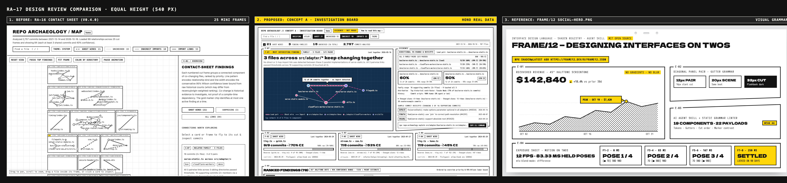
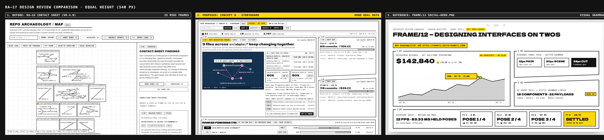

# RA-17 · Investigation Board Design Review & Production Briefing (`--style rich`, Take Two)

This directory contains the design review artifacts and verification snapshots for **RA-17**: two art-directed FRAME/12 concepts (`Concept A: Investigation Board` and `Concept B: Storyboard`), the first-class empty state (`concept-empty.html`), the real Hono `MapData` snapshot (`hono.mapdata.json`, 2,757 commits at `08807ce1`), and side-by-side comparison sheets against RA-16 (`v0.4.0`) and FRAME/12's `social-hero.png`.

**Approved Production Direction:** **Concept A (Investigation Board)** with Concept B's diagonal `<PanelPair>` treatment (`slant-bottom` / `slant-top`) is wired into [`src/map/template.ts`](../../../src/map/template.ts) (`renderRichMapHtml`) as the default **`Briefing`** mode alongside the **`Atlas`** contact sheet (`Briefing | Atlas` toggle).

All HTML concepts, production Briefing data, and screenshots are generated deterministically from real `buildMapData` output and pure formatting functions in [`src/map/copy.ts`](../../../src/map/copy.ts) via [`scripts/design-concepts.mjs`](../../../scripts/design-concepts.mjs) — zero numbers or commit hashes are hand-typed.

---

## Side-by-Side Comparisons (`540px` Equal Height)

### Concept A — Investigation Board

### Concept B — Storyboard

---

## Concept Walkthroughs: The Four User Jobs

### 1. Finding the most relevant relationship in 5 seconds
- **Shared selection algorithm (`selectFeaturedFinding` in `src/map/copy.ts`):** Both concepts promote the single highest-priority finding to Cut `C-01` using `overviewPriority`, Wilson 95% confidence lower bound, and `score`. Panel cuts use `C-01`–`C-06` while findings use `F-01`–`F-78`. On Hono, `C-01` immediately surfaces `F-01`: the 3-file parallel implementation family `serve-static.ts across src/adapter/*` (`bun`, `deno`, `cloudflare-workers`).
- **Concept A (Investigation Board):** Uses a top-level 4-metric stat band (`21 GHOST WIRES`, `3 FINDING FAMILIES`, `15 UNCHECKED LINKS`, `2,757 COMMITS ANALYSED`) with a 45° halftone screentone header on `GHOST WIRES`, then dedicates a wide (`760px`) `C-01` panel directly below to the `Dela Gothic One` headline (`3 files across src/adapter/* keep changing together`) and the cyanotype plate.
- **Concept B (Storyboard):** Uses an asymmetric comic-page layout (`8fr / 4fr`). `C-01` is a tall hero cut on the left containing inline stat chips (`21 GHOST WIRES`, `3 FAMILIES`, `15 UNCHECKED`, `2,757 COMMITS ANALYSED`), the marker-yellow `F-01 · MOST INTERESTING FINDING` chip, the `Dela Gothic One` headline, and the cyanotype plate + evidence side-by-side inside the same cut.

### 2. Understanding why it matters
- **Plain-language copy (`formatFamilyHeadline`, `formatPairHeadline`):** Directly beneath the `Dela Gothic One` headline, the subhead explains in plain English why the finding warrants attention: *"No direct or 2-hop import link was detected between these 3 parallel implementations of serve-static.ts. All 3 pairwise links passed thresholds across 16 supporting commits (9 touched all 3)."*
- **Focused Cyanotype Plate (`computeFeaturedPlateLayout`):** Instead of rendering 25 tiny, disconnected subgraphs at once, the cyanotype plate (`#13304f` blueprint survey grid) renders only the featured finding's ego network (capped at `MAX_EGO_NODES = 12` files; 6 files for Hono's `serve-static` component).
  - The featured ghost-wire triangle is highlighted with a `--f12-marker` (`#ffd60a`) casing underneath the `--plate-tape` (`#ff4f9a`) long-dashed stroke.
  - A manga speech balloon (`12 of 20 commits together · no import detected`) points directly at the midpoint of the lead pair (`bun/serve-static.ts` ↔ `deno/serve-static.ts`), with explicit bounding-box repulsion (`balloonBox`) so zero nodes or labels collide with the balloon.
  - All node labels use 8-position (`S, N, E, W, SE, SW, NE, NW`) bounding-box collision avoidance at `12.5px` bold `M PLUS 1 Code` with a `3.5px` dark-blue halo stroke so zero labels overlap on the plate.
- **Epistemic framing (`EVIDENCE · NOT PROOF`):** The masthead carries the neutral `EVIDENCE · NOT PROOF` pill (preserving the single `--f-marker` budget strictly for `F-01 · MOST INTERESTING FINDING`) alongside a progressive-disclosure `How to read this map ▸` popover so users immediately understand that co-change is historical evidence to investigate, not proof of a missing import.

### 3. Inspecting the evidence
- **Directional asymmetry (`formatDirectionMetric`):** Both concepts show both directions side-by-side (`bun/serve-static.ts → deno/serve-static.ts: 60%, 12 of 20 commits · 95% range 39–78% (≥39% CI)` vs `deno/serve-static.ts → bun/serve-static.ts: 50%, 12 of 24 commits · 95% range 31–69% (≥31% CI)`) plus all 3 pairwise links for a family (`60%`, `50%`, `41%`) so asymmetric co-change is never hidden behind a single undirected percentage.
- **Provenance & counterexamples (`formatCounterexamplesLine`, `formatOwnerNote`, `formatOriginShareNote`):** Both concepts surface recency (`Last together 2026-05-16`), primary historical contributor share (`Top historical contributor: Yusuke Wada (75% of bun/serve-static.ts commits)`), commit origin (`Commit origin: 100% human (0% agent or bot)`), and an expandable counterexamples disclosure (`Changed alone: 8 times (bun/serve-static.ts) · Changed alone: 12 times (deno/serve-static.ts) — 20 counterexample commits ▸`).
- **Commit receipts & CLI handoff:** Supporting commit receipts (`26f8c33`, `1196f14`, `246a06a`, showing `3 of 16` family commits with `+13 more via CLI explain`) sit above the one-click shell-quoted `npx repo-archaeology explain ...` copy bar — all completely visible inside the first `1440×900` desktop viewport without scrolling.
- **Architectural difference between A and B:**
  - In **Concept A**, the evidence lives in its own dedicated `C-05 · EVIDENCE` panel (`slant-bottom` SVG polygon border) to the right of `C-01`, giving the cyanotype plate a wider horizontal canvas (`760px`) and giving the evidence cards generous breathing room.
  - In **Concept B**, the plate and the evidence columns sit side-by-side *inside* `C-01`, freeing the right column of the page for the slanted `C-02` / `C-03` `<PanelPair>`.

### 4. Moving to the next finding
- **Concept A:** Below `C-01` + `C-05 · EVIDENCE`, a 3-column secondary strip (`C-02 / F-02: tiny.ts ⇢ quick.ts`, `C-03 / F-03: stream.ts ⇢ sse.ts`, `C-04 / F-04: tiny.ts ⇢ hono.ts`) is completely visible within the first `1440×900` viewport, each with its directional confidence, 45° halftone dot Wilson 95% confidence range bar, reverse direction summary, and latest commit receipt. Scrolling down reveals `C-06: RANKED FINDINGS (78)` with full Wilson range bars, an interactive `Show all 78 findings` toggle, and deep-linkable rows (`#f=<source>..<target>`), plus the `Briefing | Atlas` segmented control in the masthead to switch to the multi-frame contact sheet.
- **Concept B:** Places `C-02` (`slant-bottom`) and `C-03` (`slant-top`) in a diagonal FRAME/12 `<PanelPair>` down the right column beside `C-01`, and brings `C-04: RANKED FINDINGS (78)` (rows `F-01` through `F-03`) directly into the bottom of the first `1440×900` viewport.

---

## Rendered Viewport Gallery

### Concept A — Desktop Light (`1440×900`), Desktop Dark (`1440×900`), Mobile Light (`390×844`)
- [`concept-a-desktop-light.png`](./concept-a-desktop-light.png)
- [`concept-a-desktop-dark.png`](./concept-a-desktop-dark.png)
- [`concept-a-mobile-light.png`](./concept-a-mobile-light.png)

### Concept B — Desktop Light (`1440×900`), Desktop Dark (`1440×900`), Mobile Light (`390×844`)
- [`concept-b-desktop-light.png`](./concept-b-desktop-light.png)
- [`concept-b-desktop-dark.png`](./concept-b-desktop-dark.png)
- [`concept-b-mobile-light.png`](./concept-b-mobile-light.png)

### First-Class Empty State — Desktop Light (`1440×900`)
- [`concept-empty-desktop-light.png`](./concept-empty-desktop-light.png)

---

## Recommendation & Trade-offs

**Recommendation: Concept A (Investigation Board) — with Concept B's diagonal `<PanelPair>` cut available when users collapse the top stat band or inspect pair-to-pair comparisons.**

### Why Concept A wins as the primary `--style rich` Briefing default:
1. **Superior Cyanotype Plate legibility (`760px` vs `520px` width):** On repositories where the featured finding is a 6–12 node ego network or a 3–5 file parallel family, Concept A's wider plate gives file paths and speech balloons significantly more horizontal room while keeping every label collision-free.
2. **Cleaner eye-tracking path (1 → 2 → 3 → 4):**
   - **Beat 1 (Top band):** Repo-wide scope (`21` ghost wires, `3` families, `15` unchecked, `2,757` commits).
   - **Beat 2 (Center-left `C-01`):** Headline + cyanotype plate with speech-balloon callout.
   - **Beat 3 (Center-right `EVIDENCE` with `slant-bottom` cut):** Directional stats, counterexamples, commit receipts, and CLI explain command.
   - **Beat 4 (Bottom strip `C-02`–`C-04`):** Three secondary findings side-by-side inside the first `1440×900` viewport, followed by `C-05` Ranked Findings below the fold.
3. **Trade-off of Concept A vs. Concept B:**
   - **Concept B's advantage:** Concept B feels even closer to an asymmetric manga page at first glance because the diagonal `C-02`/`C-03` `<PanelPair>` sits in the upper-right column and the top rows of `C-04: RANKED FINDINGS (78)` appear inside the first `1440×900` viewport without scrolling.
   - **Concept B's cost:** Squeezing both the cyanotype plate and the 2-column directional evidence cards side-by-side inside `C-01` (8 of 12 columns) narrows the directional route headers (`bun/serve-static.ts → deno/s…`) and gives the cyanotype plate ~30% less width than Concept A.
